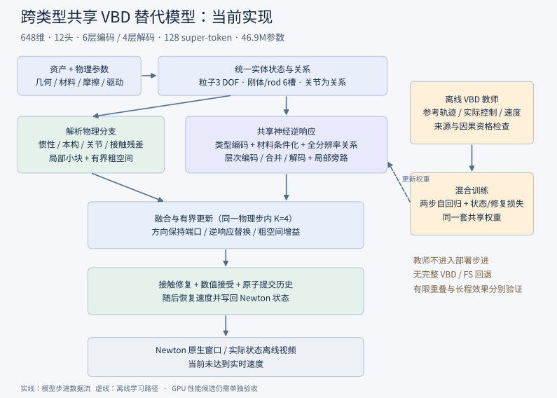

# 当前共享 VBD 模型架构

更新日期：2026-11-15。本文说明源码中的实现及其验证边界；运行产物、检查点和原始数据不随源码发布。

## 网络与统一表示

模型主体是 `MixedSolver` 内的共享 `protected_response`。实体先按类型编码到 648 维，物理关系保留原分辨率，通过关系消息和材料 FiLM 条件化；层次编码器最多保留 128 个 super-token，6 层编码与 4 层解码均使用 12 头注意力，FFN 宽度为 1296。配置中的 legacy `width=64` 不代表共享主干宽度；共享主干由 `protected_width=648` 控制。完整分辨率关系旁路补回局部信息。方向保持的向量端口、受限逆响应替换和粗空间增益共同给出修正，活跃参数为 46,882,811。

统一状态使用位置、四元数、线速度、角速度和历史量。粒子只开放 3 个平移自由度；刚体及 rod 段使用 6 槽自由度。关节是刚体之间的关系，包含锚点、轴、限位和驱动，而不是另一套独立场景网络。内部以质心定义刚体平移量，对接 Newton 时恢复原生状态。

材料条件包括软体 Lamé 参数、布料膜/面积/弯曲刚度、rod 拉伸/剪切/弯曲/扭转及阻尼；刚体使用质量、质心和完整惯量；接触使用摩擦、法向刚度和阻尼。物理量通过时间步、质量和长度等尺度进入无量纲共享特征。数值运动预算、松弛和展开轮数与材料参数分开。

## 一个物理子步

1. 冻结时间步起点、控制输入和历史，查询真实接触候选，构造惯性/外力目标。
2. 解析计算材料、有限关节和接触残差与小块响应。
3. 构造有界粗空间和可学习逆响应，使用同一共享网络生成更新；当前每个子步 4 轮，四轮并不代表四次物理时间推进。
4. 经曲率尺度、运动包络、接触修复及接受规则处理提议，原子提交状态与历史，再恢复速度。
5. 写回 Newton 状态，供窗口或离线渲染使用。

部署步进不构造完整 SolverVBD 或 SolverFeatherstone，不读取教师轨迹。解析小块算子、几何检查和有限修正是新求解器的一部分，全部计入耗时。当前允许小幅接触重叠，重点是避免大穿透及不合理变形；离散采样检查不构成连续无穿透证明。

## 离线数据与训练

官方范围为 42 个纯 VBD demo；9 个外部后端耦合场景排除。另有五类混合对象场景与自建 Franka—软块场景，使用同一个网络。自建 Franka 保留原 URDF 质量、惯量和 mimic；离线单 VBD 参考显式改为每个物理步最后一轮投影 mimic，未修改 Newton 文件。这属于公开记录的数值适配，不是原封不动的官方 SolverVBD，也不进入模型推理。

新抓取数据记录了 h=1/600 的 1500 个物理转移、实际控制和速度。数据检查绑定源资产及代码哈希，检查控制因果对齐、每个子步的四面体定向和 mimic 误差。当前研究训练在一条轨迹上使用不同阶段开发窗口，不宣称独立材料或形状泛化。

两步自回归训练的状态项为 `1e4 × normalized_position_MSE + 100 × SO(3)_rotation_MSE`，另加原始提议对脱离计算图的局部修复目标的监督；修复项含 1000 系数。两个 hop 平均后乘 `((1/120)/h)^4`。AdamW 只更新共享 `protected_response`；新课程使用 1e-6 学习率和新优化器历史，不继承父检查点的合格状态。

69 组旧数据原样保留，新增 1 组抓取数据；每轮 78 次更新，其中新抓取数据重复 9 次，两轮共 156 次。156 次更新已完成，最终开发复测因用户暂停而未完成，选中步数仍为 0。Franka 开发 loss 分别为 0.0390959、0.0394369、0.0398761；综合相对分数为 1.0000、1.0307、1.1537。比例分数可能受非常小的基准 loss 影响，必须同时看绝对误差和任务轨迹，不能宣布收敛。

## 已验证和仍待验证

2478 权重在 125 粒子软块、9 个机器人刚体的独立接近抓取状态下，h=1/600 推理 1.95 s，抬升约 9.93 cm，并保持半秒；末端位置误差约 1.97 cm。118 个记录状态的检查中没有四面体翻转，软体—机器人最大接触深度约 1.18 mm，刚体约 5.31 mm；这些数值不能证明所有子步或连续路径都无穿透。

同初始状态和控制的 h=1/60 对照没有把软体抬起。原 GPU 推理耗时 978.4 s，网络和物理更新均在 CUDA，离线视频渲染与诊断另行执行。完整接近动作、所有官方 demo 的长轨迹、留出材料/拓扑和实时速度仍未验收。

静态 mimic/关节树拓扑缓存、标量 Gram 分解快捷路径已在 CPU 对照中保持正向与 231 组参数梯度一致，并检查开关、系数、所有权和张量替换的失效。精简诊断保留数学计算和接受规则，只省略逐分量列表。`--neural-graphs` 与 `--neural-precision bf16` 为独立实验性选项；源码包含 autocast 策略分键与捕获期间禁用权重缓存的保护，但这些新增 GPU 路径尚未完成 GPU 验证，不能宣称提速。

下一步是 GPU 等价性/耗时对照、完整接近—夹紧—抬升轨迹、损失与采样策略复查，以及更多材料和多对象耦合数据。低摩擦导致的合理滑落应与数值失效区分；当前单材料关节粗空间也必须扩展后，才能声称支持任意多材料机器人耦合。
