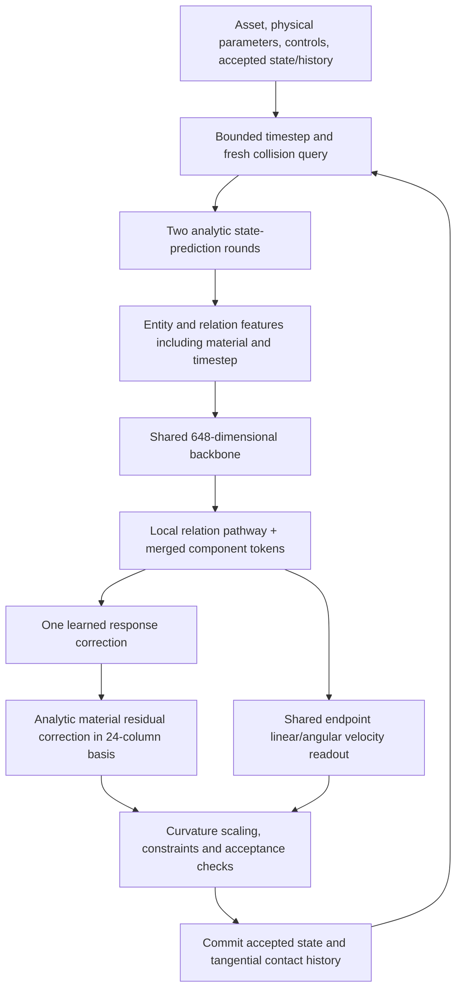

# Current shared VBD architecture: v24

The cross-type architecture is new research beyond the original WorldParticle.
One `wp_vbd.mixed_solver.MixedSolver` checkpoint processes particles, cloth,
rigid bodies, finite joints and rod/cable relations. Material, mass/inertia,
friction, drives and timestep remain explicit inputs.

- Width 648, 12 attention heads, 6 encoder and 4 decoder layers, FFN width 1296.
- Shared-response plus shared-velocity-head parameters: **46,884,109**.
- Per physical step: two analytic prediction rounds and one neural round.
  Nominal output schedule: three physical steps per 60 Hz output frame.
- A 24-column low-frequency material space supplies analytic elastic residual
  corrections. Learned elastic-direction and learned contact-seed heads are off
  in the selected configuration.
- Endpoint velocity uses this step's shared latent, not a second backbone pass.
- Accepted Coulomb-bounded surface tangent history, metric-consistent mimic
  projection and periodic bending differences remain explicit operators.
- Contact-aware initialization and other numerical policies are recorded per
  scene. Difficult intervals can be subdivided down to 1/600 s and are counted.
- Neural and principal physical tensors execute on CUDA in GPU runs. Python,
  asset/control work, synchronization and recording still have CPU costs.

Native VBD is an offline teacher/reference only. Model inference does not call
VBD, Featherstone or a native-solver fallback. Substantial analytic physics
remains; this model is not a direct single-pass state predictor.

Selected artifact and exact configuration: [v24 cloth40 snapshot](../model_releases/shared_vbd_v24_cloth40/README.md).
The six robot demos passed full-task checks, but measured end-to-end execution
is only about 0.46–0.92 FPS. There is no demonstrated general speed advantage
over native VBD and no all-42-demo rollout claim for this fine-tune.

See [the robot suite](robot_demo_suite.md), [cloth fine-tuning](robot_cloth_finetuning.md)
and [analytic predictor/corrector design](analytic_predictor_corrector.md).
