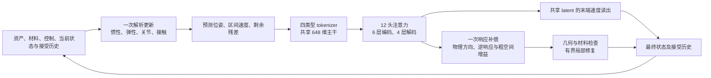

# 共享解析预测与监督补偿 v24

> 当前最终配置、Franka/W1 验收结果与复现命令以 [本版修改总结](current_working_changes_v24.md) 为准。下文保留研究过程，一轮解析预测、未通过的中间用例和已清理的临时路径不代表当前方案。

本版本将学习弹性方向试验从默认训练路径移除，恢复解析材料形变方向，用共享大网络监督补偿有限解析预测的剩余误差。保留旧权重用于比较；没有用原生 VBD 修正模型演示的状态。



解析和网络阶段属于同一个物理区间，共用 GPU 上的状态与接触上下文；中间不写回原生状态、不重新积分时间。网络看到解析更新后的位姿、区间线/角速度、剩余力学残差、关系和显式步长。位移响应与末端速度补偿共同接受监督，速度读出也使用大网络 latent，不再另设独立的小型特征网络。

`analytic_predictor_rounds=1`、`unroll=1` 表示一次解析阶段加一次网络阶段，不是一次总物理运算。解析阶段和补偿阶段都会组装残差/曲率并进行实际接受检查。每帧三子步时名义上为三次神经调用、六次响应更新；拒绝恢复的所有额外工作应另外计数。内部推进下限保留 1/600 秒。

## 弹性与耦合

四面体、膜、弯曲和 cable 的本构力仍按显式材料计算。平滑弹性方向使用原有 24 维物理基上的小型解析响应，不训练 `ElasticShapeDirectionHead` 或学习切向种子。共享网络仍影响最终有限预算响应，因此此版本不宣称材料运动与网络完全隔离。

多对象和 cable 的物理粗空间采用明确的 32 列上限，网络宽度和参数共享方式不变。它是小型物理子空间，不形成全局稠密动力学逆。几何、材料有效性和接触候选完整性仍由物理接口检查。启用自适应恢复时，必须区分名义预算、真实接受子步、失败尝试和解析应急回退。

## 独立 VBD 数据

新入口为 `scripts/collect_vbd_augmentation.py`，不是将旧 demo 切窗凑数量。计划生成十类、每类 33 条，共 330 条独立初始化并实际推进的原生 VBD 轨迹：每类 30 条训练、3 条独立开发。类型包括刚体、软体、布料、cable–布料、关节机构、刚体–软体、刚体–布料、软体–布料、关节–软体及多类型耦合。

各轨迹分别变化尺寸、密度、弹性、弯扭刚度、摩擦、初始运动或驱动。耦合场景按落体接触、支撑、压缩与回撤等可解释方式布置；不使用其他动力学求解器。每条使用 1/1800 秒原生步长、32 轮 VBD，记录 0.5 秒轨迹，每十个细步保存一次，得到 180 Hz 的真实物理终点及末端速度。没有对接触标签插值。CUDA 图复用细步执行，采集时使用设备内记录，最后按轨迹批量回传保存。

每条单独筛查记录状态有限性、四面体体积、速度和原生接触容量。需要刚体–材料接触的耦合类还要求观测到对应动态接触候选。未通过的种子不进入课程，另行记录。此筛查不等于连续碰撞证明或精确收敛保证。

## 200 次快速监督训练

`scripts/train_analytic_corrector.py` 更新共享主干和共享末端速度读出，约 46.9M 个可训练参数；解析弹性方向无待学习参数。每次优化器更新累积两条独立训练轨迹，顺序遍历全部 300 条后再重复；另回放既有合格 Franka/夹爪数据。W1 保留作独立推理用例。

快速试训通常使用一个学生步，每第十次更新及验证使用两个自主推进步；后一步使用学生自己的状态和历史，不重置到教师。学生步长混合 1/180、1/90、1/60 秒，既有教师保留各自原始采样间隔。损失使用按对象归一的位姿、线/角速度、动量、应变、体积、接触和抓取相对误差。200 次更新用于首轮效果与 loss 检查，不预先称为收敛。

开发曲线使用固定的十条独立轨迹、固定起点和固定步长；训练结束额外检查全部三十条独立轨迹。原生 VBD/Featherstone 构造和推进在训练器内被禁止。训练报告记录主干梯度、真实神经阶段、已见轨迹、拒绝窗口及显存。

## 数据驻留与边界

- 原生关节控制用 Warp/Torch 存储视图读取，不经过 `numpy()`。
- 固定资产模式缓存关节拓扑和物理属性，动态驱动目标仍逐步刷新；改变资产或材料需要重建或显式重新验证。
- 已加载轨迹和场景驻留设备，400 场景缓存覆盖本次课程；训练激活不卸载到 CPU。
- 接触拓扑未变时直接比较设备张量，减少重复导出完整索引；拓扑变化、接受分支和诊断仍包含 CPU 同步。本版本没有宣称整个求解循环均已 CUDA 图化。

## 当前入口与结果位置

```bash
WP_VBD_NEWTON_ROOT=.local/newton_pinned_25298 .venv/bin/python -u \
  scripts/collect_vbd_augmentation.py --output .local/my_v24_data \
  --per-family 33 --samples 90 --device cuda:0

WP_VBD_NEWTON_ROOT=.local/newton_pinned_25298 .venv/bin/python -u \
  scripts/train_analytic_corrector.py --collection .local/my_v24_data/collection.json \
  --checkpoint .local/multirate_20261118_v2/physics_heads_release_200/step_000200.pt \
  --output .local/my_v24_train --updates 200 --device cuda:0 \
  --replay-manifest .local/multirate_20261118_v2/data/macro_index_release_v5/data_manifest.json
```

本次数据、训练、机器人验证及清理清单统一保存在 `.local/analytic_predictor_20261119/`。Franka 使用原成功用例的材料、驱动刚度和夹爪姿态；W1 使用原软袋和斜夹姿态，从独立初始状态运行。结果应分别报告任务完成、形变、穿透、真实调用与耗时，不能以视频帧率替代推理帧率。

退役的弹性方向训练/采集/审计脚本已从活动入口移除，源码小备份位于该目录的 `before/retired_elastic_tools.tar.gz`。旧实验中间权重和重复预检权重清理约 12.1 GiB；原始 VBD 轨迹、报告、有效视频、冻结 step156 和上一版 step200 仍保留。旧 `multirate_training.md` 中相关路径属于历史记录，当前训练以本页入口为准。

## 本轮实测结果与限制

已实际完成 330 条轨迹和 200 次更新，而非待执行计划。`augmentation_audit.json` 核对了 330 个不同种子、不同资产/参数描述和不同轨迹内容，训练/开发为 300/30，累计 300300 次原生 VBD 细步，记录物理时长合计 165 秒。这里的“独立”指分别初始化和仿真的轨迹；结构模板为十类，不是 330 种完全不同的拓扑。每条仅 0.5 秒，不覆盖机器人完整任务的全部长期行为。

训练更新 46884109 个共享主干和末端速度读出参数，全部 300 条新训练轨迹及三条原有课程都参与过更新。固定十条开发轨迹的均值：初始 1.20572、50 次 1.18493、100 次 1.17347、150 次 1.17256、200 次 1.15917，下降约 3.86%。全部三十条独立开发轨迹末次均值为 1.62015，没有被拒绝的窗口；该集合不同，不能直接与十条开发均值作前后比较。训练曾有一个窗口被拒绝并重新抽样。采样观测进程显存峰值为 7674 MiB。

CPU 上固定十条独立窗口的同预算对照，纯解析两轮均值 1.22248、未训练的新结构 1.20543、训练后 1.15908。训练后相对纯解析下降约 5.19%，但关节、cable–布料、软体–布料和关节–软体等项未一致改善。这是短窗口平均误差证据，不是完整机器人任务改善或收敛证明。

| 完整独立模型运行 | Franka 抓软块 | W1 抓袋装块 |
| --- | --- | --- |
| 物理时长 / 输出帧 | 4.5 s / 270 | 4.8 s / 288 |
| 接受子步 / 主干调用 / 响应更新 | 810 / 810 / 1620 | 876 / 876 / 1752 |
| 内部最小步长 | 1/180 s | 1/360 s，12 个名义子步被运动预测预先细分 |
| 拒绝重试 / 解析应急回退 | 0 / 0 | 0 / 0 |
| 推进墙钟 / 观测输出 FPS | 1076.4 s / 0.25 | 582.5 s / 0.49 |
| 原生 VBD/Featherstone / 教师读取 | 全为 0 | 全为 0 |
| 任务与质量 | 最大质心抬升 36.28 mm；末端跟随误差约 57.1 mm，未通过原有 50 mm 筛查；保持时仍有约 6.29 mm 相对质心下移 | 方块最大抬升 343.2 mm，末段 37 帧的八角点在实际闭合袋壳内，左手双侧承载采样比例 98.69%；任务子检查通过 |
| 形变与几何 | 非刚体 RMS 峰值 16.92 mm，四面体体积比 0.595–2.901，形变偏大；记录帧最大机器人–软体表面重叠 1.044 mm | 袋子非刚体 RMS 峰值 2.48 mm，最大局部位移 8.80 mm，未达到现有可见形变要求；左夹爪几何采样深度为 0，桌面间隙约 11.83 mm |

因此这版权重为**完成训练和完整运行、视觉质量未通过的实验候选**。Franka 的质心升高混有拉伸，不能等同于整块脱离桌面的成功抓取；W1 的任务成功不能替代袋子形变验收。没有降低验收阈值，也没有改软材料来制造变形。录像分别为 `franka_analytic_corrector_200.mp4` 和 `w1_bag_analytic_corrector_200.mp4`，loss 图为 `train200/loss.png`。

推理期间存在其他 GPU 作业及首次核加载，以上为记录到的墙钟，不能当作隔离条件下的性能比较。只减少神经调用尚未证明端到端加速。接触查询、解析弹性投影、接受检查和每帧日志/录制仍消耗明显时间。

后续应先处理低预算状态更新的有限迭代误差，并增加与实际机器人动作匹配的长程监督。单独扩大关节方向预算的闭爪预检没有改善，因此没有作为默认修正加入。现有 200 次模型权重保留，短窗 loss 改善不作为继续堆训练轮数的依据。

权重 `train200/step_000200.pt` 为 188092439 字节，SHA256 为 `2ab3420550327224e50b2152a93737f5af1743cde01fdcd0fe56fcddf7e89159`；`checkpoint_verification.json` 已验证严格加载、有限权重、新架构和共享速度头。模型本轮没有推送远端。

## 后续研究：材料剩余误差的解析修正

`src/wp_vbd/analytic_material_response.py` 新增可关闭的 `analytic_elastic_postsolve`。此前的解析模块将每个物体的 24 个平滑材料方向压为一列，之后局部和网络响应改变状态，而没有重新求解其余材料方向的剩余误差。新试验保留解析材料基，在完整响应提议后求一次小型修正，不增加神经前向。

设当前局部物理曲率为 `H`、残差为 `r`，已有响应提议为 `u`，已有受保护粗空间算子为 `Q`。材料基 `B` 去除整体刚体运动及固定自由度，并进一步变为 `B̃ = B - Q(HB)`。计算剩余误差 `r* = r + Hu`，求 `c = -(B̃ᵀHB̃)⁺ B̃ᵀr*`，得到 `u* = u + B̃c`。同一交互中的不同材料保留交叉项，秩亏方向通过相对特征值截断处理。有限性和物理外层几何/merit 接受检查继续执行；没有直接覆盖粒子状态。

该计算冻结物理基和小系统分解，但对网络提议的剩余误差保留反向梯度。测试覆盖独立伪逆比对、秩亏、交互耦合、固定自由度、粗空间能量正交、世界旋转/平移一致性及有限非零梯度。测试入口为 `scripts/verify_analytic_material_response.py`。

新试验的显式预算为每个材料至多 4096 节点、24 个方向，每个实际交互组件的候选方向默认至多 96；互不相干的物体不共用这一预算。超出预算明确拒绝，尚未扩展为任意大场景通用实现。每次修正增加两个宽材料块和一个向量的物理曲率作用，以及小系统特征分解；不能把“没有新增网络调用”解释为没有新增成本。无材料的场景直接返回。

同一 step200 权重、同一完整场景参数的首轮对照保存到 `.local/analytic_material_20261119/`。十条固定独立短窗口的训练模型平均误差从约 1.15908 降到 1.07992，但不能以此替代完整场景质量。Franka 的首轮完整运行显示非刚体 RMS 峰值由 16.92 mm 降到 11.91 mm，质心最大抬升由 36.28 mm 增到 47.18 mm；仍存在保持下移和局部压缩，不能宣称已达到最终效果。

进一步微调准备使用“两次解析预测＋一次共享网络补偿”，每帧三子步仍只需名义三次神经前向。该预算由显式 `--analytic-predictor-rounds 2` 指定，完整物理响应轮数必须同时报告。机器人回放使用 `--replay-hops 8 --replay-every 2 --balance-robot-phases`，在相同材料和摩擦下分阶段采样夹取、抬升、保持、释放；窗口必须落在已有合格训练段内，不延伸到开发段。每个窗口内使用学生预测状态连续推进，不从教师逐步重置。其余 300 条新轨迹继续回放，以监测跨类型退化；W1 保持为推理用例，不加入本轮训练。

长窗口 GPU 预检通过后才启动额外 200 次微调，输出预计为 `long_train200/`；之后独立运行和视频写入 `long_review/`。执行状态以同目录 `long_pipeline.json` 和训练报告为准，此处描述不代表这些工作已完成。

## 完整 demo 数据课程（2026-11-19）

上述额外 200 次长窗口微调已经完成：固定十条独立开发窗口均值从 1.00215 降至 0.95244，
但完整 Franka 的形变更差，W1 袋子的可见形变也未通过，因此该次权重不作为后续默认起点。
独立最低点检查显示，该次 Franka 的材料最低点最高仅离桌面约 3.67 mm，质心升高不能算整块成功抓起。
之前同一初始权重、一次解析预测加材料修正的对照最低点可离桌面约 45.28 mm，持续约 1.1 秒。
不同解析预算、短窗口误差与完整任务质量之间的关系仍需分别验证。

新的联合课程从保留的 v24 初始候选开始，将 42 个独立 VBD 官方用例的完整记录过程，
与 300 条新增训练轨迹、30 条独立开发轨迹及两份 Franka 长窗口回放联合使用。
为满足完整时长要求，补齐了陀螺、硬布悬挂、cloth twist、Dahl 滞回及另外两条 cable 轨迹。
数据覆盖约 246.6 秒原生物理过程、152022 个保存状态，保持 9 个外部求解器耦合用例排除。
42 个用例的 GPU 前向与反向预检全部通过；实际权重训练的计数以新报告为准，预检不计作优化覆盖。

课程的完整时间轴、保留开发区间、显存策略、断点恢复和真实覆盖统计见
[完整 demo 训练说明](full_demo_training.md)。输出目录为 `.local/full_demo_20261119/`。
用户在第 100 次看到平台后要求停止追加训练；进程停止前记录到第 105 次，
完整推理/视频复测选择已验证的第 100 次权重。独立十条开发轨迹均值在第 50、100 次分别约为
0.984576、0.984553，基本持平。该权重实际使用了 34/42 个官方用例，未完成正常全覆盖选择条件，
因此作为用户指定的平台期对照保留。剩余源数据已准备，但不自动补训。
当前只执行完整机器人推理和视频检查；不能以文件清单、42 个接口预检或旧的 200 次结果替代实际权重覆盖。

### 大步长补偿还需检查的位置

当前主干主要学习残差到更新的响应，接受规则仍偏向降低当前大步长的隐式目标。
这与直接学习细步物理推进的有限时间结果并不等价。增加解析迭代可能更接近大步长隐式解，
却不一定更接近细步教师端点。共享速度头可以修正末端速度，但不能解除位置更新在零残差附近的表达限制。

独立的一维弹簧计算给出反例：质量 1、刚度 100、初始位置 1、速度 0，以 1/60 秒推进。
一次隐式 Euler 得到位置 0.972973，十次 1/600 秒推进得到 0.984777。
前者是该大步长二次目标的极小值，目标值约 48.64865；后者在同一目标上的值约 48.90643。
因此，严格下降规则不能从前者走到后者，零残差乘逆响应也不能产生这段非零位置补偿。
计算记录为 `.local/full_demo_20261119/macro_objective_counterexample.json`。
这是时间离散与当前学习参数化可能不匹配的数学例子，尚未证明它就是机器人失败的实际原因。

本轮完整课程与 200 次对照保持原定模型。若完整任务仍未改善，下一步应在真实机器人窗口中
比较细步目标与当前大步长目标/残差，再评估学习惯性目标或等效载荷补偿，
或在解析初值后预测状态补偿并做有限几何/约束投影；不应仅以增加宽度、数据量或解析迭代替代该检查。

### Franka 抓取的投影条件数问题（2026-11-19）

本轮冻结平台期第 100 次权重，未继续训练。匹配初态、控制和物理参数的逐轮检查发现，
双指 mimic 投影是一个独立且可测量的问题：局部响应使用冻结对角块逆，
其前后的 mimic 投影却使用质量逆。当局部逆受接触、关节和驱动刚度支配时，
质量投影仍保持约束与下降方向，却会大幅放大方向的物理曲率，导致有限预算更新极小。

在起提初态的一轮解析响应中，投影前后的线性下降量均为 275.642，
曲率却由 181.121 增至 345625.956；物理曲率缩放因此只允许约 0.000798 的比例。
相同窗口的运动范围缩放为 1，没有接触激活缩放。这将问题定位到响应投影，
而非碰撞运动范围或单纯的网络容量不足。

实验修正使用同一冻结局部逆 `B` 构造
`P = I - B C^T (C B C^T)^+ C`，残差与提案分别经过 `P^T` 和 `P`。
不改变 mimic 几何、材料、摩擦、非线性接受规则、网络参数或调用预算。
位置的有界非线性 retraction 仍保留原有实现。
实现入口为 `mimic_metric_tangent`，Franka runner 支持 `--mimic-metric-tangent` 显式对照。

CPU 物理算子检查覆盖真实起提与保持接触状态：约束切向、原/对偶转置、幂等性、
局部度量能量不增、响应对称正定性及残差反向传播全部通过。
修正后第一轮投影前后曲率约为 0.673103、0.672825；
0.1 秒自主短程的手部误差从约 6.34 mm 降至 2.46 mm，保持窗口从约 0.88 mm 降至 0.24 mm。
这些窗口从离线教师状态初始化，仅用于诊断，不能当作独立完整抓取成功。

实验与审计目录为 `.local/grasp_diagnosis_20261119/`。
`projection_probe/report.json` 保存旧投影逐轮证据，`matched_metric_cpu/report.json` 保存修正窗口，
`mimic_metric_contract.json` 保存算子检查。
仅修正投影的完整 GPU/CPU 对照已分别完成于 `metric_tangent/`、`metric_tangent_cpu/`，
机器人闭合明显改善，但软块仍滑落，因此不能把短窗口改善当成解决抓取。

增加完整关节方向没有改善匹配窗口；完整对照在命令保持阶段仍未整块离台。
追加刚体块方向虽能准确解其冻结线性子块，匹配窗口改善也很小。
这两项未选实验已从主路径移除，仅保留本地源码压缩包与诊断结果。

进一步对照启用了已有的表面切向历史：跨物理子步匹配接触特征，保留上一步被接受的切向力，
重新投影到当前接触平面，并按当前 `mu * normal_load` 截断；接触打开后力归零。
这改变切向状态的处理方式，摩擦系数、法向材料和 Coulomb 上界保持不变。
同时修正 `surface_joint_system.finish` 的提交错误：原来读取的子 context 比最终接受的力旧一轮，
现在只提交父 context 中对应软/刚接触的最终切向力区间，不混入随后追加的自接触乘子。

投影与切向历史联合后，GPU/CPU 都完成了约 0.5 秒的整块悬空保持，最低点始终离桌约 113 mm。
两次对照在释放落桌后的约 4.37 秒处因 native Float32 读回的 mimic 舍入误差中断，
此时所有解析/网络提案都可被接受，最终严格关节检查却不通过。
保存的拒绝状态通过已有的有界读回修复，只修正约 `1.11e-8 m`，同一步就正常通过；未放宽关节容差。
Franka 入口现在与 W1 一样启用该修复，并记录次数和最大修正量。

最终独立 CPU 重跑位于 `final/franka_cpu/`，已完成 4.5 秒、270 帧、811 次网络主干调用，
其中一次是运动范围限制触发的主动细分；无拒绝回退、无新增训练、无原生 VBD/Featherstone 调用，也没有读取教师轨迹。
保持阶段所有材料顶点离桌至少 112.75 mm；张爪后质心下降 114.64 mm，末帧与机器人接触为零。
全程去除刚体运动后的形变 RMS 峰值约 3.95 mm，四面体体积比约在 0.565–1.401 之间。
最终 GPU 重跑 `final/franka_cuda/` 也已完整完成：810 个物理步、810 次主干调用、零回退，
保持阶段最低点离桌至少 113.07 mm，全程形变 RMS 峰值 3.77 mm。
离散几何检查的机器人/软体最大表面重叠约 0.139 mm，四面体体积比约 0.568–1.395。
CPU/GPU 均包含完整释放落桌；视频分别为 `final/franka_cpu.mp4`、`final/franka_cuda.mp4`。

W1 的完整 CPU 对照 `final/w1_bag_cpu/` 已通过抓持、实际袋壳包含和可见形变检查：
878 个物理步/主干调用（名义 864 步，快速运动触发局部主动细分），最后 37 帧所有方块角点都在实际袋壳内；
左手双边接触比例 100%，最小机器人可视网格/桌面间隙 12.55 mm。
袋子非刚体 RMS 峰值约 10.94 mm，局部位移峰值约 37.98 mm；
对原始左手网格及纸张三角形内部以 2 mm 间距采样，未发现纸张进入手爪可视实体。
W1 首个 GPU 对照在约 1.605 秒触发状态拒绝；详细日志重跑 `final/w1_bag_cuda_v2/` 完整通过，
但默认紧凑模式又复现相同拒绝，因此没有将一次重跑成功当作修复。
从保存的模型状态恢复完整初始关节参考后，同一状态在 CPU/GPU、紧凑/详细日志四种组合均拒绝，
排除了“详细日志本身解决问题”的解释。初次重放漏掉初始 FK 参考，结果已经标记无效，未作为修复证据。

最终定位是折角表示边界：一个折边从 `+pi` 越到 `-pi` 时，原先直接相减的弯曲角与阻尼角产生近 `2*pi` 跳变。
同一保存状态的弯曲能由 0.0049301 跳到 0.0051429，而连续角差对应的能量仅为 0.0049328；
阻尼能还引入约 0.011 J 跳变。候选步缩小到 1/1024 仍存在有限跳变，零步才恢复原值，
因此原接受检查会拒绝全部非零提案，增加网络轮数或减小时间步无法根治。

新增 `periodic_bending` 配置统一处理弯曲力、跨物理步阻尼、神经关系特征和接受目标中的
`atan2(sin(angle-reference), cos(angle-reference))` 局部角差。
弯曲刚度、阻尼系数、摩擦与接受阈值不变，主干结构和权重不变。
旧配置默认保留原策略；W1 入口默认打开，可用 `--no-periodic-bending` 复核旧策略。
继续运行旧记录必须保留它的角差策略，不能无标注切换。
这是一项物理角度表示修正，并非声称逐项复现该固定 Newton 版本的原始未环绕减法。

保存的失败状态在 CPU 和 GPU 上都已用相同三轮响应直接接受全部提案（alpha=1），
无需新增网络调用。真实四点折边的跨界连续性与阻尼力/势能梯度检查也通过。
结果见 `w1_periodic_cpu_probe.json`、`w1_periodic_gpu_probe.json` 和 `periodic_bending_contract.json`。
修正后默认紧凑模式的完整 GPU 任务 `final/w1_bag_cuda_periodic/` 已通过：
288 帧、4.8 秒、878 个物理步/主干调用，零拒绝回退，最小主动细分步长约 1/360 秒。
方块抬升峰值约 362.23 mm；最后 37 帧全部方块角点位于实际袋壳内，左手双侧接触比例 100%。
袋子形变 RMS 峰值约 10.94 mm，局部位移峰值约 37.56 mm，最小三角形面积比约 0.936。
原始手爪可视网格与袋面另有全保存帧的离散穿透审计，结果写在 `final/w1_periodic_geometry.json`。
GPU 推理录像输出 `final/w1_bag_cuda_periodic.mp4`，帧为真实模型轨迹的离线渲染。
播放帧率也不代表实际推理速度。

当前两份机器人入口默认启用匹配局部逆的 mimic 投影与表面切向历史；
显式 `--no-mimic-metric-tangent --no-surface-tangent-history` 可选择旧的响应/接触策略；
Franka 旧前缀还需保持原有 `--no-native-mimic-roundoff-repair` 设置。
旧前缀继续运行必须保留其原有策略，入口会拒绝未标注的策略切换。
一般求解器的配置开关仍可独立选择，未自动修改全部官方训练场景。
主要预算仍为 **名义每帧 3 子步，每子步 2 次解析预测加 1 次网络更新，即通常每帧 3 次主干调用**。
另有接触检测、材料小空间修正、约束投影和接触历史维护；本轮没有以增加主干调用或训练次数换取成功。

### 网络收益的独立消融

`final/franka_physical_only_cpu/` 在同样名义三轮响应预算下关闭全部网络路径（包括共享末端速度修正），
保留材料小空间、约束和接触流程，也完成了 4.5 秒完整抓取释放。
其 810 个物理步没有主干调用；保持阶段最低点离桌至少 111.44 mm，形变 RMS 峰值约 3.33 mm。
网络 CPU 对照实际为 811 步，因各自轨迹的运动范围限制并非完全相同的步长序列；
两次运行还受同时运行的其他任务影响，不能直接据墙钟时间作性能结论。

该消融说明，当前简单 Franka 场景的成功主要依赖已修正的物理流程，不能据此宣称大网络必需或已获得加速。
下一阶段应先在更少解析响应、关闭部分昂贵材料修正、更多复杂对象耦合的匹配预算下比较，
再确定大网络应监督并替代哪些计算；没有理由仅因这个案例继续追加训练轮数。
下次训练应显式采用同一弯曲角差策略，并审计跨表示边界的折叠布/袋参考数据；
不应把原始角差跳变作为网络必须学习的补偿目标。本轮保持用户要求的停止训练状态。

### 起提时底部短暂“粘桌”的原因

完整抓持通过不代表起提过渡已经自然。用户检查视频后指出底部存在短暂拖拽：
2.35 秒时，25 个底面顶点中仍有 4 个停在约 0.203015 m，其他顶点已经升高。
桌面顶为 0.2 m，粒子半径为 3 mm，因此这 4 点的实际表面已经微微离桌，却几乎没有向上速度。
它们在约 2.4 秒才明显脱离，形成尖角被桌面拉住的观感。

为区分接触历史与迭代误差，独立 CPU 推理补录了完整接受状态、速度、摩擦历史和控制，
再对同一 2.35 秒状态做单步对照。关闭桌面摩擦历史、关闭桌面预判接触曲率均不改变停滞。
逐轮记录则显示，自由落体 warm start 先将最低点从离桌 3.015 mm 推到 2.714 mm，
重新激活桌面法向接触；其后 3 轮响应主要修复这约 0.3 mm 的人为压入，
各轮最低点约为 2.714、2.939、2.985 mm。离开接触所需的低曲率阶段直到再下一轮才出现。
每个子步重新采用同样初值，导致小范围释放误差反复积累，看起来像粘附。

同一历史与控制下，仅在诊断中跳过靠近桌面的材料顶点的自由落体 warm 位移，
保留原惯性目标、物理材料、时间步及 2 次解析预测 + 1 次网络更新，
4 个顶点单步向上位移由约 -1.6～3.7 微米变成 6.43～6.68 mm，提案全部通过接受检查。
这是初始候选与有限预算接触释放不匹配的证据，单步对照本身不等于完整轨迹验收。

数据位于 `.local/table_release_20261120/`，关键报告 `warm_start_equal_budget.json`。
`warm_start_ablation.json` 的最后一个变体曾受配置字典别名影响多出一轮响应，
已用配置拷贝修正，并由记录实际轮数的等预算报告取代，不能将旧变体当作等预算证据。

用户随后授权实现，已增加 `contact_aware_warm_start`：只对自由飞行候选中将压入静态表面的材料顶点，
去除其指向接触面的法向分量。接触法向的局部张成空间用小型 3×3 因子处理多方向接触；
切向与离开表面的运动保留，动态接触和不会触及表面的远处顶点不变。
物理惯性目标、材料力、摩擦、接受检查及解析/网络轮数都不变。
Franka 入口默认启用 `--contact-aware-warm-start`，旧版本可用 `--no-contact-aware-warm-start` 对照。
缺少该配置的模型保持旧行为，W1 等其他入口未自动切换该策略。

完整 GPU 推理 `.local/table_release_20261120/franka_cuda/` 已完成 4.5 秒、270 帧、810 个物理步，
网络主干调用 810 次，零拒绝回退，零新增优化器更新，原生 VBD/Featherstone 调用均为零。
以所有底部粒子扣除 3 mm 半径后的表面离桌超过 1 mm 计，时间从 2.383 秒提前至 2.233 秒；
超过 5 mm 则从 2.400 秒提前至 2.250 秒。新轨迹不再出现原先 4 个顶点长期停滞后一起跳起的高度曲线。
起提早期仍有正常的接触与形变过渡，不能表述为起提命令发出即完全无接触。

0.5 秒保持阶段最低顶点离桌始终至少 112.99 mm，释放后正常落桌且末帧与机器人接触为零。
去除刚体运动后的形变 RMS 峰值约 3.19 mm，四面体体积比约 0.646–1.045。
271 个保存状态的几何审计中，机器人/软体表面重叠峰值约 0.154 mm。
结果和离桌曲线位于同目录的 `hold_audit.json`、`geometry.json`、`release_comparison.json/png`，
完整双视角视频为 `franka_contact_warm.mp4`。
