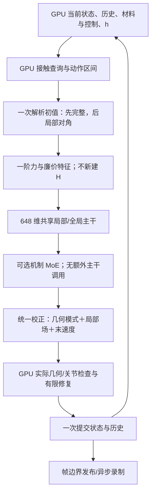

# v33 大优化设计：GPU 常驻、直接学习响应与条件计算

状态：**DESIGN_ONLY，未实现、未训练、未更换默认权重**。日期：2026-11-21。

冻结基线是远程提交 `873ef8d0`、标签 `shared-vbd-v32-a1-20261121`，权重 SHA256 `b73dbd02f92adcf7ee9b82587fa937c967b1d8f165ecb1974d10cc206c4b5c60`。本设计承接 v4.1 的跨类型共享、显式物理参数、有限解析预算与独立验证，按后续用户要求允许小误差和小穿透，优先避免明显穿模、错误变形及隐藏补迭代。

## 1. 本轮决定

1. 下一版的主要变化是**学习实际状态校正，删除网络阶段对新 H、逆块、受保护粗空间和能量 Gram 的依赖**。当前 v32 的网络阶段依然运行这些计算，单独换读出头解决不了主要问题。
2. 保留一次解析初值，先沿用 v32 的完整解析初值验证新响应，再把它替换为质量/参考刚度对角近似。两种初值分别命名和计数，不把便宜初值继续混称为原 A1。
3. 状态、历史、候选和网络特征常驻 GPU。减少内循环的主机标量读取与动态分组；保留必要的设备内转换，不能把所有 copy 都说成 CPU/GPU 往返。
4. 首先保留 648 维共享主干，建立直接响应 dense 对照；容量候选为四个 FFN 使用 4 或 8 个共享专家、top-1/top-2 条件激活。专家按机制和状态路由，不按 demo 或对象类型拆成独立求解器。
5. 先在名义 3 子步下验证替代关系，再训练 2 子步、每子步一次共享主干。步长补偿必须进入训练，实际细分/修复/调用次数全部统计。

本设计不承诺实时或固定倍数加速，也不把未实现的模块写成现有能力。

## 2. 已核实的瓶颈和数据路径

v32 新短窗使用同一份新权重、同一个 Franka 保持状态：3 组预热后交错样本中，reference 中位 1.161 s/帧，fused_graph 0.517 s/帧。它是执行策略对照，不是新网络替代结果，也不代表其余场景能得到相同比例。

同一次插桩的 fused_graph 帧内：主干调用 3 次，所包围区间约 21 ms；物理装配 6 次约 85 ms；关节方向增广 6 次约 46 ms；接受搜索入口 9 次约 96 ms；整个插桩区间约 640 ms。区间有嵌套，包含 CPU 提交间隙和插桩开销，**不可直接相加或视为 GPU kernel 忙碌占比**。这些证据支持优先减少物理/调度重复，不能据此认定网络容量已经足够或没有扩容价值。

| 数据路径 | 当前实际含义 | 下一版处理 |
|---|---|---|
| `wp.to_torch` | Warp 1.17 的实现提供同一设备内存视图，本身不拷贝数据 | 保留互操作与所有权引用 |
| `.double()`、原生状态 `copy_` | CUDA 场景下主要是 GPU 内精度/布局转换和设备内复制 | 融合转换、复用缓冲区、减少重复读写 |
| 接触计数 `int(tensor)`、`bool`、部分 `equal` | 小标量读到主机也可能阻塞 GPU 流 | 设备掩码、合并状态码、稀疏遥测 |
| 动态拓扑/分组与部分 `tolist` | 可能把 GPU 结果交给 Python 决策 | GPU 索引/分段规约、版本化缓存、固定容量接口 |
| 帧录制 `.numpy()` | 显式设备到主机读回 | 异步 pinned 双缓冲，计算与录制分开计时 |
| 初始化 `shape_gap.numpy()` 等 | 初始化阶段往返，不能算每子步的常态传输 | 与热运行分别报告，不作为首要替代目标 |

源代码依据：`mixed_contact_runtime.py` 的 read/query/write、`surface_joint_runtime.py` 的控制刷新、`soft_surface_ports.py` 的接触计数和快照，以及各 runner 的帧录制。不能仅统计 `.copy_` 或 `.to()` 次数就声称传输了多少主机数据。

零复制也不等于零同步；互操作的流与事件仍需测量。当前还没有足够的 memcpy 字节证据把整体瓶颈归因于主机带宽。

实施前补充 Nsight/CUDA 证据：H2D/D2H/D2D 字节与次数、同步次数/栈、CPU 提交间隙、各阶段调用数、网络/物理/控制/录制耗时。已有 CPU/流区间只能定位，不能替代这些测量。

## 3. 哪些计算交给网络

| 当前计算 | 提议的新职责 | 推理端删除/保留的边界 |
|---|---|---|
| N 阶段重新装配 H、局部逆块 | 共享网络直接预测规范化校正场 | 删除 N 阶段新 H、逆块与 Cholesky；输入采用廉价特征和初值缓存 |
| N 阶段 H 定义的粗空间/约化求解 | 学习对象整体和跨对象长程响应系数 | 删除该阶段 H-Gram/分解；用预计算几何基及局部通路表达响应 |
| 六方向逆响应中的在线能量 Gram、小块逆替换 | 学习方向的实际幅值及组合 | 不再通过 `energy_gram`、`inverse_replacement` 给学习方向重新解析求幅值 |
| 最终材料模式幅值与重复曲率投影 | 学习几何模式和局部形变的总校正 | 基础几何保留，N 阶段不做 H 模态投影或材料约化求解 |
| 多候选完整能量评估 | 小头预测步幅，实际几何/约束做有界验证 | 删除 N 阶段完整 merit 搜索；不靠网络安全评分放行状态 |
| 接触/关节迭代中的耦合响应 | 共享关系消息和条件专家参与总校正 | 实际碰撞、接触几何、合法 DOF、限位和有限修复保留 |
| 子步缺失的时间演化 | 条件于 h 学习粗时间推进误差 | 通过小步教师聚合训练；不在部署临时补教师或完整 VBD |

继续保留高价值廉价物理：质量惯量、重力与已知外力、材料参数和一阶力/应变特征、实际碰撞几何、SO(3) 姿态更新、必要的关节/几何检查。优先学习求解响应，暂不把便宜且已有物理定义的本构定律全部换成 MLP。

## 4. 目标计算图与调用契约



### 4.1 初值与时间所有权

输入为 `S0, history0, actions[t,t+h], h`。解析初值只是**同一个物理区间内的初始猜测**，得到 `S_seed`；网络产生 `delta = target - S_seed` 的校正，不再推进第二个 h。只有最终接受结果提交历史、计入物理时间。

先保留完整 A1 作为可追溯对照。后续局部初值采用质量、惯量、参考材料刚度和接触对角近似，规模有界，使用逐自由度倒数/小块运算，不构造全局 H 或受保护粗空间。其离散残差、单位和积分版本须单独登记；它是近似初值，不是精确解。

不得把解析初值已产生的响应与多个独立网络分支再次无条件叠加。第一版不同时预测完整状态、完整接触冲量和完整材料位移再把三者相加。

### 4.2 新输入契约必须断开昂贵依赖

新建 `direct_response_v33` 输入布局，不直接复用依赖当前 `physical/baseline/metric` 的旧 encode。

允许输入：当前和初值状态、质量惯量、参考几何、材料/摩擦/阻尼、控制与历史、h、接触间距/法向/相对速度、实际一阶残差、初值提议。完整 A1 阶段已有的逆块可以作为明确标注的旧线性化缓存用于过渡，但禁止为填特征再构造一套新 H/逆块；局部初值版本不再要求这些输入。

建议规范化包括 `v*h/length`、`omega*h`、`r*h²/(mass*length)`、形变不变量、间距/length、无量纲驱动刚度和材料时间尺度。转动使用相应惯量/力矩尺度，不能套用平移质量单位。

必须实现真正的 `forces_and_features_only` 路径：材料节点、接触、关节和 rod 只生成需要的一阶力/力矩/特征。当前某些 `linearize=False` 调用仍生成局部块，不能以关闭返回值冒充减少计算。通过计数证明 N 阶段没有调用 `elastic_nodes` 的完整块路径、`ProtectedCoarse`、`energy_gram` 或逆替换。

新输入图的连接分量、局部关系和路由从静态结构及实际几何候选构建，不得依赖先生成 H 的 term list。新步进入口也不继承需要 H 的旧 root/下降检查；采用独立且版本化的直接响应契约。

训练时可以使用更昂贵的教师/导数。若采用冻结物理特征梯度，需显式登记近似反传契约；部署无 H 不等于训练从不计算导数。

### 4.3 一次主干、统一更新

保持全分辨率局部关系通路和有界全局 token。不同对象按 DOF/关系特征适配，同一个主干处理材料、机器人和接触耦合，不允许按 demo ID 选网络。

一次 latent 供应以下读出：

- 局部校正：由廉价的协变向量字典生成平移/转动校正，避免直接用世界坐标标量 MLP 破坏旋转性质。
- 对象几何模式系数：学习整体与低频形变响应；不在线求 H 度量下的幅值。
- 末速度修正：沿用共享 latent；需要增加方向能力时单独消融，不能只靠改速度掩盖位置/形变错误。
- 步幅/误差估计：辅助调度与缩放，不能替代实际几何检查，也不能为了选 h 额外跑大主干。

采用参考质量度量下的几何分解，控制局部与整体重复表达：

```text
Q0^T M_ref Q0 = I              # 资产初始化时完成，最多约 30 列/对象
Q = T Q0                      # T：参考坐标到当前坐标的分块旋转
M_g = T^(-T) M_ref T^(-1)      # 几何参考度量随同坐标运输
P_mass(u) = Q (Q^T M_g u)
delta = Q*a + (u_local - P_mass(u_local))
```

Q0 在静态合法 DOF 上构建，低秩列带显式掩码；度量与基同坐标运输，保持 `Q^T M_g Q = I`。不能旋转各向异性惯量的基却仍套用未旋转的参考度量。固定/释放 DOF 或拓扑变化须版本化并重建相关基，不能仅事后清零后仍宣称正交。该分解能减少重复表达，**不是旧 H-正交保护空间**；实际基运输与投影的协变性、固定点和秩退化都要测试。运行时不建立新的 H-Gram。几何参考度量也不等同于当前能量 Hessian。

第一阶段保留最大坐标的刚体 twist 和明确预算的关节几何投影。树形机器人的广义坐标读出作为后续候选：FK 使用预测的关节状态，不把 IK 目标直接当实际姿态。闭链、特殊关节及 rod 历史逐项按固定 VBD 支持范围验证。

接触专家首先是共享特征处理器，不单独添加另一份完整接触力。若以后学习物理冲量，需要独立核实离线量的力/冲量单位、前缀贡献记账、接触出生/消失的 ID 对应和正反作用分配；目前不能假设解析位置更新天然提供可相减的准确接触冲量。

### 4.4 接受与修复

新直接响应不再继承旧近似逆的正定/下降保证；SPD 参数化或质量正交也不能自动证明整步物理正确。

实际检查保留：有限值、合法 DOF、关节误差、检测运动包络、严重体积/面积反转、明显接触重叠。N 阶段最多验证 3 个预定缩放候选，检查复用几何，避免每个候选重新计算完整材料 merit。

优先做 GPU 局部修复，提议预算为 2 次并行局部扫次，难例最多 4 次；不构造 H-Gram、不重跑大主干、不调用完整 VBD。仍失败时最多对该区间细分一次并重新预测，所有失败提议、修复和额外网络调用计入实际工作。未解决时报告失败、保留最后有效状态，不把冻结画面标成正常推进。

接触历史、关节累计角、可选路由历史和缓存都采用事务提交。失败/细分不得重复累计切向历史或提前增加物理时间。允许原定义下的小穿透，不新增连续零穿透承诺。

## 5. 条件激活与模型容量

dense 648 维直接响应是必要对照。MoE 插入位置提议为编码层 4/5、解码层 2/3 的 FFN（从 0 计数），保留共享注意力、关系编码和局部通路。

每个专家是 `648 -> 1296 -> 648` 的 FFN。路由根据当前材料、应变、接触、驱动和时间尺度等因果特征选 top-k；不按机器人型号、对象类别或 demo 硬分专家。期望形成结构响应、接触/滑动、关节耦合和长步/历史等机制能力，但专家语义是研究假设，需要利用率和行为消融验证。

| 四个 FFN 替换方案 | 总参数预算 | 单 token 路径参数代理量 |
|---|---:|---:|
| 当前活跃网络参照 | 47.14M | 47.14M |
| 4 专家、top-1 | 67.33M | 47.15M |
| 4 专家、top-2 | 67.33M | 53.87M |
| 8 专家、top-1 | 94.24M | 47.16M |
| 8 专家、top-2 | 94.24M | 53.88M |

这些是**仅替换现有 FFN**的可复核预算，未加入新特征适配器/读出，也未扣除退役旧头；最终结构可能不同。参数计算器与结果见 `scripts/estimate_v33_capacity.py`、`docs/designs/v33_capacity_estimate.json`，已用实际四层 FFN 的参数量核对。

路径代理量不是整帧激活参数或实际 FLOPs：不同 token 可路由到所有专家，一帧可能访问全部专家权重。8 专家方案仅 FP32 权重就约 377 MB，AdamW 权重/梯度/两组动量约 1.51 GB，均未含激活、物理状态、缓存和工作区。top-k 不会让未选专家的常驻权重/优化器状态消失。

工程约束：所有专家驻留同一 GPU；路由、排序、分段运算在设备端完成，不做 CPU 专家换入换出，不为每个模块再跑一次主干。丢 token 对物理求解不可接受；采用无损分组/分块计算，溢出增加的路由块与延迟显式记录。固定容量/掩码和 GPU 分组 GEMM 是目标，不能声称普通 Python 循环路由已经达到此目标。

初始化复制 dense FFN，使归一化专家组合可保留初始函数；训练使用轻量的跨样本负载平衡和路由稳定性监督，推理固定确定性路由。容量调度不得强迫每一帧专家均匀，物理状态本身可能偏向一种机制。

默认候选先测试 4 专家 top-2，保留 8 专家 top-2 扩容选项。还必须比较 dense 加宽 FFN 的相近矩阵乘预算，区分容量收益与路由开销。MoE 只有在材质/耦合泛化改善且端到端代价合适时才进入默认；参数增加不作为成功指标。

## 6. GPU 常驻运行协议

`GPUState` 持有 FP64 位置、姿态、速度和历史；神经特征/权重先保留 FP32。不同精度转换在 GPU 融合，不在此次结构替代中同时改成低精度物理。

现有原生 FP32 往返也构成了旧轨迹的量化语义。GPUState 先提供兼容模式，在同样边界重现 FP32 量化、四元数和 COM/origin 转换，再独立评测连续 FP64 状态模式。后者会改变数值轨迹，不能当作纯复制优化；训练与部署必须采用相同的状态精度契约。

- 静态拓扑、质量、惯量、参考模式、DOF 映射和材料版本在资产加载时建立；参数改变要显式递增版本并重建相关缓存。
- GPUState 在连续子步间保持所有权；原生 state 用于碰撞查询和帧发布，不再每子步从原生 FP32 状态重建完整 FP64 状态后又读回。
- 碰撞需要的 FP32 body origin/particle 缓冲通过一次融合设备内转换生成。原生碰撞/渲染格式不同，不能承诺完全无 D2D 拷贝。
- `ContactBatch` 包含容量、GPU valid/count、稳定 feature ID、owners、权重、法向和间距。消除 `int(count)` 后必须替换下游动态形状契约，不能只删断言。
- 分桶不能丢接触或截断候选。超容量应有完整的 GPU 分块路径或受计量的扩容/重新查询；只在边界允许的主机决策要记录次数和耗时。
- Warp/Torch 使用一致流或明确事件，维持视图所有者存活；未完成的查询/内核不能覆盖网络正在读的缓冲区。
- 异步录制同样要持有源缓冲区直至复制事件完成；不能为了删 clone 让下一子步覆盖尚在录制的数据。
- 每子步的有限值/几何标记在 GPU 合并，使用掩码提交；主机只在必要的失败、外部控制或遥测边界读取。逐一登记尚存同步点，不以删检查获得加速。
- 原始帧、关节读出和统计通过 pinned 环形缓冲异步写出；算子吞吐、含控制步进、含记录、开窗和离线渲染分别计时。IK/控制频率保持原每帧一次，不再混淆每子步调用频率。

## 7. 数据和监督

当前 300/30 增广、42 个纯 VBD demo、抓布与已有机器人轨迹继续使用。只接纳固定 Newton 版本的纯 VBD 教师，不混入外部求解器耦合。

必须先统一训练入口：现 `train_analytic_corrector.py` 的可训练前缀不含新材料头，且全量 rollout 尚未加入新辅助监督；当前 `train_robot_cloth_corrector.py` 也未实现真正的变量 h 训练。这是实施工作，不因文件中有 h 输入就算完成。

### 教师与输入隔离

1. 固定 v32 在学生当前状态生成完整响应标签，供直接响应/特征适配蒸馏。教师可以建立 H/Gram，学生输入不得读取它的未来状态或新建矩阵。
2. 充分计算的纯 VBD 和细步聚合状态提供独立动力学监督。明确它是同离散求解标签还是时间演化标签。
3. 新旧特征对齐时先训练廉价适配器/新读出，可暂用节点 latent 蒸馏维持已有主干，再联合更新。主目标始终是实际状态和自主滚动效果。

初值后目标为学生自己的 `S_seed` 到教师终态的校正；不能把教师初值/接触历史放入学生输入。接触和摩擦历史必须从被接受的学生状态推进，不在每个 hop 重置成教师值。

中段参考若没有完整接触/关节历史，采用因果 burn-in 或带完整学生历史的回放起点；不能任意补零后称为相同物理状态的模块真值。

### 步长数据

名义 h 从 1/180 扩展到 1/120，并覆盖二者之间和部分更大步长作为训练条件。初始部署只验收 2 子步，不直接宣称 1 子步成立。

已有部分增广仅保存 1/180 间隔，无法直接给出 1/120 的真实端点。旧数据保留用于回放；大步标签使用可整合的细参考数据或补采。建议支持 1/360 保存网格：1/180、1/120、1/60 分别为 2、3、6 个真实记录间隔；教师原生小步可更细。其他参考使用实际时间戳及累计时长，不伪造整数 stride 或以线性插帧充当 VBD 真值。

同一物理区间的控制、外力、pin 运动和移除事件必须匹配。主要监督为细步聚合的状态/速度/形变和交互；大步单次离散残差只作相容辅助，不能同时强迫聚合轨迹与另一套大步离散方程残差严格为零。

### 质量与困难样本

Piper 只读诊断已确认：相同资产、物理参数和完全相同 motor targets 下，旧 v24/A2 最小单元体积比约 0.605，新 v32/A1 约 0.043；新例发生在下放阶段 3.083 s，最多 1/320 个单元在 3 个保存帧内低于 0.15。整体最小体积比例约 0.864，对照为 0.876，最终最小单元比恢复至约 0.965。它是局部瞬态退化，不能描述成整块塌陷；权重和预算同时变化，因果归属还需交叉对照。

数据增补优先覆盖下放/挤压、接触建立与释放、软体角点/边缘、布料承载和 rod 耦合。材料、摩擦、驱动刚度、尺寸和运动组合必须合理，不为凑数量制造失真的教师。

loss 包括规范化位姿/速度、自主短滚动、对象内形状、接触相对运动与滑移、体积/面积/拉伸及修复需求。局部极端形变用对象内尾部统计和持续时间补足全局均值，依据教师/材料允许的压缩范围设软惩罚，不把所有可压缩材料强制成同一个体积下限。不追求与 VBD 每点完全一致。

按完整资产/材料区间/动作组合划分训练与开发；同资产时间窗仅作开发信号，不声称未知资产泛化。数据先保留 CPU 存储，选定完整窗口一次上传 GPU，避免训练每个 hop 往返主机。容量和 rollout 长度在最大场景上实测，不把 FFN 参数显存估计当总训练显存。

## 8. 实施顺序与消融预算

| 阶段 | 部署变化 | 关键目标 |
|---|---|---|
| 0 | 冻结 v32，给另外三例验证图执行策略；补同步/传输计数 | 建立相同执行策略的公平基线 |
| 1 | 新廉价特征与直接响应，仍用一次完整解析初值，仍 3 子步 | 删除 N 阶段 H/粗空间/Gram 和完整 merit 搜索 |
| 2 | GPUState/ContactBatch 接口与局部对角初值 | 删除反复原生读写和完整解析初值中的全局代数 |
| 3 | 同一训练课程混入更大 h，部署 2 子步 | 减少实际物理步、网络调用、查询和修复总工作 |
| 容量对照 | 在相同直接响应版本比较 dense、4/8 专家 | 确认条件计算的材质/耦合收益值得代价 |

GPU 常驻接口可与阶段 1 并行开发，但接受时分别打开开关，不能把执行策略、删算子、减步长和 MoE 的收益混成一个数字。

名义计数（材料对象存在，固定步场景；不是全部物理操作数）：

| 指标/输出帧 | v32 3 子步 | 直接响应＋完整初值，3 子步 | 直接响应＋局部初值，2 子步 |
|---|---:|---:|---:|
| 主要完整 H 装配 | 6 | 3 | 0 |
| 主干前向 | 3 | 3 | 2 |
| N 阶段 H-Gram/逆响应求幅值 | 存在 | 0 | 0 |
| 完整初值材料约化求解 | 3 | 3 | 0 |
| 一阶物理计算 | 随完整装配与检查 | 完整初值＋force-only 特征 | 每步初值/特征的 force-only；另列最终接触历史更新 |
| N 阶段完整 merit 搜索 | 3 | 0 | 0 |

不把表中 0 解读为没有质量/惯量、碰撞、关节投影、局部小矩阵或几何修复。额外接触重查、候选、细分、失败尝试和专家溢出都登记到实际计数。

候选实现文件（尚不存在/未接入）：`gpu_state_runtime.py`、`force_features.py`、`direct_response.py`、`conditional_experts.py`、`direct_acceptance.py` 和统一训练入口。旧 v32 原文件/权重保持可复现，新契约使用新架构标识，不靠几个旧配置开关改写旧权重含义。

## 9. 验收与停止规则

- 必须通过小系统/恒力与自由转动、材料载荷、关节驱动、双向接触及各类型历史检查；损失曲线不能代替这些测试。
- 首先六个机器人完整任务与相机相同的对比视频，再逐类扩到 42 个官方 demo。报告实际采用的新路径，未支持项明确标注，禁止静默切回旧求解链后称全覆盖。
- 保留原明显穿透门槛，增加局部尾部变形、持续时间、接触丢失/滑移和长期漂移报告。允许少量误差；不让一次极值代替所有视觉和物理判断。
- 强制登记 `full_H_assemblies`、`energy_gram_builds`、分解/粗空间构造、主干次数、实际接受子步、修复/失败/重查和主机同步；任何假删除都不通过。
- 耗时分别报告首次编译、预热后的步进、完整任务、控制与记录。相同显卡负载/精度/资产/控制条件比较；范围重叠的插桩区间不求和。
- 设计目标为阶段 1 的完整步进有实质下降（以约 25% 作为研究目标），后续争取约 2 倍整体改善；这是目标而非已测结果，未达时依据分项数据调整，不声称已实时。
- MoE 需要与 dense 同计算预算/同实际延迟对照；路由坍缩、切换抖动、跨类型信息丢失和溢出都属于失败信号。
- 开发 loss 进入平台即停止追加轮数；模型选择同时考虑完整滚动与材料尾部质量。不要依靠更多解析轮或后台教师补救候选效果。

不承诺新直接响应继承旧 H-正交、下降、全局稳定、精确角动量守恒或连续无穿透证明。自由运动、动量/能量与旋转性质分别测试；对已知外力和静态支持要采用正确的收支条件。

## 10. 容量与发布管理

所有新专家权重常驻 GPU，不采用每个模块从 CPU 临时调入参数的模式。大场景显存预算需统计全部参数/梯度/动量、激活、接触容量和临时工作区，先单场景、再最大场景 preflight。

只归档通过验证的候选，不把每次实验权重和日志放进 Git。后续更大的模型/完整训练状态优先使用发布资产或对象存储并记录 SHA；当前 v32 分块与冻结标签保持不变。是否能精确续训须单独验证数据游标、采样器/CPU/CUDA RNG 和优化器恢复，不能只凭文件存在作保证。

## 11. 参考与适用边界

- [项目 v4.1 原目标](plans/WorldParticle_VBD_Replacement_Plan_v4.1.md)：共享模型、显式材料、物理与网络协同，以及完整 VBD 不参与部署回退的范围。
- [当前 v32 证据](shared_material_prefix_v32.md)、[六例检查](v32_six_scene_validation.md)：已经落地的基线和局限。
- [GNS，ICML 2020](https://proceedings.mlr.press/v119/sanchez-gonzalez20a.html)：借鉴图消息传播学习动力学，以及训练扰动缓解滚动误差；本文的机器人/多材料共享与预算删除仍需自身验证。
- [MeshGraphNets，ICLR 2021](https://arxiv.org/abs/2010.03409)：参考网格局部关系学习；不把论文速度结论直接作为本项目结果。
- [Switch Transformers，JMLR 2022](https://jmlr.org/papers/v23/21-0998.html)：参考按输入选择专家的条件计算思想；其通信开销和训练稳定性问题同样需要考虑，语言模型吞吐结论不能迁移为物理求解速度承诺。

本文件是下一轮可审查设计，不表示直接响应、GPU 调度新接口、MoE 或大步长训练已经完成。
