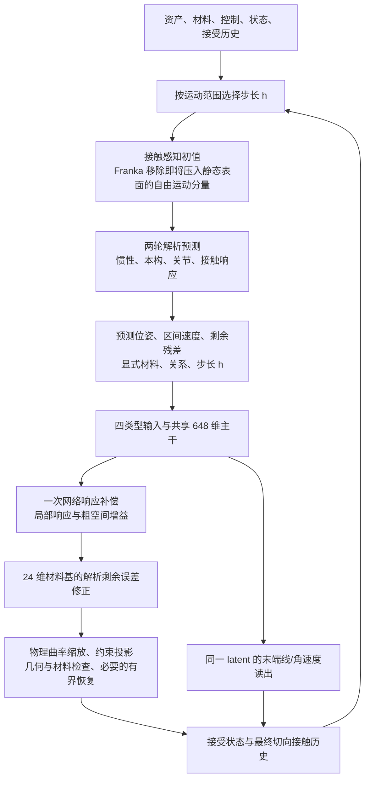

# 当前修改区：解析预测与共享网络补偿 v24

比较基线为 Git `e4386321257d41c108f46dbd7fdb8b4c06cdf187`。本文说明当前有效方案，其他研究文档保留试验过程。当前发布版及权重见 `model_releases/shared_vbd_v24_cloth40/`，六例入口见 `docs/robot_demo_suite.md`。

## 架构与计算预算

共享主干仍为 **648 维、12 头注意力、6 层编码、4 层解码、前馈宽度 1296**。训练器更新约 46.884M 参数；检查点全部模型张量含冻结项/缓冲共约 46.993M 元素。新增共享末端速度读出为 648→2，共 1298 个参数。没有新建机器人专用网络。



各响应阶段推进同一个时间区间，中间不重新积分时间。材料修正在各响应轮中按配置启用，图中只画一次模块，不代表每步只求一次。

| 项目 | 修改前基线 | 当前两个验收用例 |
| --- | --- | --- |
| 每显示帧子步 | 10，通常 h=1/600 s | 名义 3，通常 h=1/180 s |
| 每子步共享主干前向 | 4 | 1 |
| 名义每帧网络调用 | 40 | 3，减少 92.5% |
| 名义物理响应轮数/帧 | 40 轮带网络响应 | 9 轮：6 轮解析 + 3 轮神经补偿；另有材料小系统、几何和接受检查 |
| 弹性 | 原有解析本构与材料粗空间 | 沿用解析方向，增加 24 维材料剩余误差修正；学习弹性方向关闭 |
| 末端速度 | 主要由位移重建 | 共享 latent 的有界读出，监督细步教师末端速度 |
| 失败处理 | 固定步长调用为主 | 显式运动/时间/尝试预算，失败不提交状态与历史；恢复成本单独记录 |

该预算属于保存的最终配方。本次发布的六个机器人入口默认名义三子步；旧实验仍可显式指定参数复现。W1 因运动范围主动细分，真实调用略多。当前不宣称 1/60 或 1/30 秒单步在完整机器人任务中已经通过。

## 修改区最终保留的代码

| 范围 | 主要文件 | 修改内容 |
| --- | --- | --- |
| 解析预测与网络补偿 | `mixed_solver.py`、`rigid_contact_solver.py`、`rod_solver.py`、`terminal_velocity.py` | 显式区分解析/神经阶段；网络读取解析更新后的位姿、区间速度和剩余残差；速度头复用共享 latent |
| 材料响应 | `elastic_shape_modes.py`、`analytic_material_response.py`、`protected_response.py` | 6 个仿射应变 + 18 个二次位移方向；去除刚体/禁用自由度及已有粗空间分量，求小型半正定系统；分块刷新残差，不丢弃额外对象 |
| mimic 约束 | `mimic_constraint.py` | 原/对偶投影使用与局部响应一致的冻结逆块，避免质量投影放大接触与驱动曲率；几何 retraction 保留原约束 |
| 接触历史 | `surface_tangent_memory.py`、`surface_joint_system.py` | 特征一对一匹配、切平面重投影、按当前 μN 截断；分离清零；提交最后接受的父上下文力，修复保存上一轮旧力的问题 |
| 折叠布料 | `bending_angle.py`、`physics.py`、`material_damping.py`、`mixed_physics.py` | 弹性、阻尼、关系特征、目标函数统一采用跨 atan2 分支连续的局部角差 |
| 离台初值 | `contact_warm_start.py` | 只移除即将压入静态表面的初始向内分量，不改惯性目标、材料、摩擦、轮数或接受阈值 |
| 多步长与自主窗口 | `adaptive_step.py`、`supervised_step.py`、`multirate_*.py`、`mixed_contact_runtime.py` | 教师细步、学生变步长；因果控制、自主 rollout、失败回滚和有界恢复；完整记录真实工作量 |
| GPU 与内存 | `general_joint_export.py`、`contact_ports.py`、`math3d.py`、`gpu_budget.py` | Warp/Torch 控制视图、固定拓扑缓存、减少接触中间张量、独立小矩阵分块特征分解、只回收空闲缓存 |
| 数据与复现 | 采集/训练/审计脚本、`full_demo_course.py`、`augmentation_data.py` | 新增 VBD 数据、完整官方课程、覆盖统计；保存 Adam/RNG/采样器；记录源码、权重和运行策略 |

兼容旧检查点的学习弹性头、接触种子与相关验证保留为可选研究接口，当前选定配置均关闭。固定 Newton 修订为 `25298aea1691e060c86f95e8d2b773c898c006d3`，没有修改 `/home/oem/code/engine/newton`。

## Franka 夹软块

机器人刚体、关节、mimic 双指与四面体软块进入同一共享路径。控制器只发关节驱动目标，通过接触和摩擦夹起软块，保持后于 3.8 秒开爪自然落桌；没有固定软块、吸附、跟随手部或用教师状态续接任务。场景布局和抓取姿态沿用已有实现，不属于本轮新增建模。

最终参数：软块 μ=λ=5000、摩擦 1.5、机械臂驱动刚度 20000、双指闭合目标 0.024 m、偏航 −π/4；切向数值响应缩放 8，独立于物理摩擦。材料/关节粗空间和接触预期响应保留；运动检测预算 0.012 m 不是允许穿透 12 mm。

1. **有限预算抓取响应：** 旧质量投影与接触/驱动局部逆响应不匹配。同状态诊断中方向曲率由约 181 放大到 345626，使更新极小；修正投影度量后恢复跟随，不靠增加网络轮数。
2. **持续承载：** 保存接受的切向接触历史，按当前载荷截断，并修正旧力提交；没有法向吸附力。
3. **落桌精度：** 启用已有 Float32 原生读回舍入修复，约 11 nm 修复即可通过原严格 mimic 容差，没有放宽约束。
4. **底部短暂粘桌：** 自由落体初值反复将近桌点压入桌面，三轮响应不断修复新压入。现在移除初值向内法向分量，保留切向和离开方向；惯性目标与重力仍决定真实下落。

| 当前完整 GPU 验收 | 结果 |
| --- | --- |
| 时长 / 输出帧 | 4.5 s / 270 |
| 物理步 / 网络调用 / 响应轮数 | 810 / 810 / 2430 |
| 拒绝重试 / 原生 VBD、Featherstone / 教师读取 | 均为 0 |
| 连续 0.5 s 保持期最低顶点离桌高度 | 112.985 mm |
| 非刚体 RMS 峰值 / 机器人–软体重叠峰值 | 3.189 mm / 0.154 mm |
| 开爪后质心下落 / 最终机器人–材料接触行 | 114.812 mm / 0 |

最后一次初值修复的配对结果：所有底面表面离桌超过 1 mm 的时刻从 **2.383 s 提前至 2.233 s**；2.35 s 的最小底面间隙从约 **0.014 mm 增至 15.719 mm**。两者均为 2 轮解析 + 1 轮网络，同权重、同参数。这是本轮 v24 修复前后对比，不是旧 40 次网络/帧模型与新权重的单变量比较。

最终视频：`.local/table_release_20261120/franka_contact_warm.mp4`。同目录保留轨迹、源码快照、保持/几何审计和离台对比。修复前有效 GPU 记录保留在 `.local/grasp_diagnosis_20261119/final/franka_cuda/`。

## W1 左手抓袋、右手装块

沿用已有 W1 原始资产、左手斜夹姿态与 `flexible` 袋子。机器人、自由刚体方块和三角膜/弯曲袋子统一进入当前路径，没有运行原 `mjvbdv2` 混合求解 demo。袋子没有绑爪、固定袋口，方块不跟随指定轨迹。当前粗袋模型不含把手与袋子自接触。

左爪通过接触保持袋口，右手从桌上夹起方块，送至袋口松爪；方块在重力/接触下进入袋内。既有左手轻微升降及载荷带来袋体变形。膜刚度 300、弯曲 0.003、折痕 0.0006、摩擦 2.5；切向数值响应缩放 512 与摩擦系数不同。这些场景参数与斜夹姿态并非本轮新发明。

本轮重点是少网络调用下的稳定性：统一 mimic 投影和切向历史；修正折角跨 ±π 时的虚假近 2π 弹性/阻尼跳变。原失败状态在 CPU/GPU 均可复现，修复后按原三轮响应、完整步幅通过，完整任务也通过，没有增加恢复轮数或放宽穿透标准。

| 当前完整 GPU 验收 | 结果 |
| --- | --- |
| 时长 / 输出帧 | 4.8 s / 288 |
| 物理步 / 网络调用 / 响应轮数 | 878 / 878 / 2634 |
| 名义步数 / 主动运动细分增加 | 864 / 14；最小接受 h=1/360 s |
| 拒绝重试 / 原生动力学 / 教师读取 | 均为 0 |
| 方块最大抬升 | 362.23 mm |
| 最后 37 帧 | 方块八角点均在实际闭合袋壳内 |
| 抓袋后双侧接触采样比例 | 100% |
| 袋子非刚体 RMS 峰值 / 最大局部位移 | 10.94 / 37.56 mm |
| 机器人可视网格–桌面最小间隙 | 12.55 mm |

289 个保存状态按 2 mm 间隔对纸张及左爪六个封闭网格采样，未检测到穿透；这是离散检查，不是连续碰撞或完全无穿透证明。封闭袋口仅用于包含关系验证，不参与物理。最新 Franka 静态接触初值修复没有默认扩展到 W1，避免混入未经验证的策略。

最终视频：`.local/grasp_diagnosis_20261119/final/w1_bag_cuda_periodic.mp4`。对应录制目录保留轨迹与源码，`w1_periodic_audit.json` 和 `w1_periodic_geometry.json` 保留任务与几何检查。

## 数据、权重与边界

- 新增 **330 条**独立原生 VBD 轨迹，十类模板、300 训练/30 独立开发，覆盖刚体、软体、布料、cable、关节及合理接触耦合。每条 0.5 s，教师 h=1/1800 s，合计 300300 次推进；不是 330 种不同拓扑。
- **42 个**纯 VBD 官方用例完整参考数据已准备，约 246.6 s、152022 个状态；外部求解器耦合用例仍排除。
- 用户要求平台期停止，选定 **step100**。这轮续训采样覆盖 **34/42 个官方用例、200/300 条新增训练轨迹**；更早的 v24 起点训练已经遍历全部 300 条新增训练轨迹。42 个官方用例尚未全部参与这轮优化；数据准备和梯度接口预检不算优化覆盖。
- 固定十条独立开发 loss：初始约 1.00215，50 次约 0.984576，100 次约 0.984553。平台不等于所有对象、完整动作、任意步长均收敛。
- 权重 `.local/full_demo_20261119/selected.pt`，188096599 字节，SHA256 `5428975fe09bb5e64de4066796f75e2dd505b3c6c1472b6bba5eb138944b013a`。同目录 `train200/recovery.pt` 保留模型、Adam、RNG、采样器；冻结 step156、早期 v24 step200 和必要对照保留。

**目前证明的是低网络调用预算下，两个完整任务的视觉和物理检查可以通过。** 推理仍计算本构残差、曲率、粗空间、材料小系统、碰撞、投影与接受检查。网络学习有限预算响应与末端速度补偿，并非一次前向替代全部物理。

同为三轮响应的纯解析 Franka CPU 对照也完成抓取释放：保持最低点 111.44 mm、RMS 峰值 3.33 mm、网络调用 0。因此该简单抓取尚未证明 46.9M 网络不可替代。主要网络与物理张量可在 GPU 执行，但控制、拓扑判定、同步、审计、渲染仍有 CPU 工作。

本次记录中 Franka 推进墙钟约 396 s、W1 约 552 s，分别输出 270/288 帧，不是实时。负载未隔离，不能据此或网络调用比值推导严格加速。下一项研究应先做同预算、同设备负载的网络/纯解析对照和分项画像，再决定减少哪些解析成本。

## 复现与清理

最终参数保存为 `configs/robot_validation_v24.json`，不依赖临时 PID/作业 JSON。从项目根目录执行：

```bash
.venv/bin/python scripts/run_robot_validation.py --scene franka --device cuda:0 --render
.venv/bin/python scripts/run_robot_validation.py --scene w1 --device cuda:0 --render
```

CPU 将设备改为 `cpu`；`--dry-run` 只打印命令。W1 可通过 `--asset /path/to/robot.urdf` 指定资产，默认 `~/下载/assets/w1-030/robot.urdf`。默认输出 `outputs/robot_validation/` 下的新时间戳目录。入口校验冻结权重哈希与 Newton 修订。

清理移除一次性诊断/探针脚本及求解器调试分支、已完成任务的日志/遥测/PID/排队脚本、失败或重复试跑、预检初始权重和未选中中间权重。保留训练 loss/覆盖统计、有效验证入口、最终视频/轨迹/源码快照、原始教师数据、选定模型与恢复状态。逐项删除清单和实际空间统计保存为 `.local/cleanup_20261120/deleted_manifest.json`。

实际删除 **6155 个文件**，按独立 inode 与磁盘分配块统计释放约 **1.670 GiB**；原始数据与选定权重未改变。清理后检查了两份教师清单的 **376 个 NPZ 路径引用**、step100 哈希及严格模型加载、91 个 Python 源文件语法、两个新入口和三个兼容入口。接触初值、周期弯曲、切向历史、真实 Franka mimic 度量、解析材料修正、自适应恢复共 **6 项 CPU 回归均通过**，`git diff --check` 通过。本轮没有重训或重新录制完整 GPU 视频；保留的是此前已完成的完整验收记录。检查摘要见清理目录的 `verification.json`。
