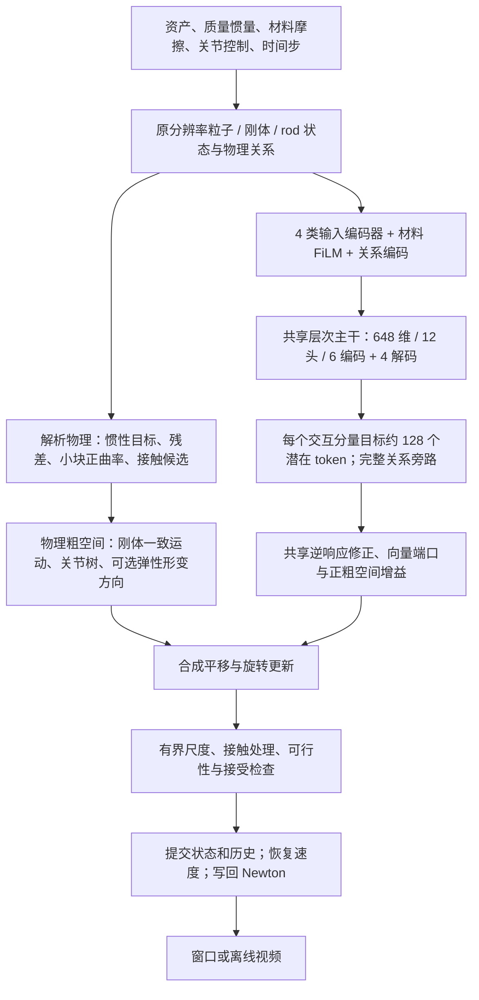

# 当前共享学习型求解框架：实现、价值与 VBD 的差异

更新：2026-11-17。依据当前源码、step 156 权重和已保留的实际轨迹。这里的任务成功、训练覆盖、收敛、泛化和加速分别计量。

**目前建立了跨类型、跨机器人资产复用同一权重的研究原型，尚未建立优于 Newton VBD 的速度或精度优势。** 如果目标只是尽快完成可靠的机器人交互 demo，目前应优先直接使用 Newton VBD。继续研究本框架的价值，在于验证学习能否减少求解成本、改善有限计算预算下的全局耦合响应；这些收益仍需对照实验。

## 当前网络实际负责什么

当前实现属于“可学习逆响应 + 解析物理算子”的混合求解器。网络依据当前状态、物理残差、材料和交互关系生成受限的更新响应；材料力、惯性、有限关节、摩擦和几何约束仍有明确的解析计算。它不直接接收一个 URDF 后一次前向预测整段动作，也不负责机器人抓取规划。

- 活跃神经参数为 **46,882,811**，FFN 宽度 1296。四类编码器对应软体、布料、刚体和 rod；机器人通过刚体及关节关系表示。
- 每个物理子步使用 **4 轮共享响应**，不是一次神经调用。W1 当前每个录制帧含 10 个子步，因此通常需要 40 次共享主干调用；4.8 秒、60 Hz 的完整袋子轨迹对应 2880 个子步。
- token 合并作用于潜在特征；物理自由度、网格、碰撞候选和历史仍保留。128 是每个交互分量的目标软预算，保留各对象时可以超过。
- 共享表面/关节路径可显式启用最多 18 列粗空间，包括至多两个自由对象的独立运动和有界关节树方向。新弹性形变方向也占用这个预算，不增加网络参数；当前每个材料对象最多 4096 节点。
- 参数、外力和控制影响解析物理及共享条件特征。机器人轨迹来自 IK 与关节目标；物体依靠接触运动，未被绑定到夹爪。
- 推理仍依赖 Newton 的资产、模型、状态、碰撞和显示接口；禁止构造或调用完整 `SolverVBD` / `SolverFeatherstone` 推进状态。它替换的是动力学步进路径，并未替换整个 Newton。

## 与直接使用 Newton VBD 的差异

Newton VBD 本身已经能够统一处理布料、软体、刚体、关节、rod 及其交互；跨类型物理支持、GPU、摩擦和材料可调并不是本框架相对 VBD 的独有优势。官方概述见 [VBD 文档](https://newton-physics.github.io/newton/stable/solvers/vbd.html)，算法的顶点块迭代背景见 [VBD 作者项目页](https://ankachan.github.io/Projects/VertexBlockDescent/index.html)。实际实验固定 Newton commit `25298aea1691e060c86f95e8d2b773c898c006d3`；不把在线最新版本的新增特性当作本地已验证能力。

| 项目 | 直接 Newton VBD | 当前共享学习型框架 |
|---|---|---|
| 动力学更新 | 解析物理与块迭代，不需要训练 | 解析物理与共享网络响应共同生成更新 |
| 学习的作用 | 没有训练得到的响应权重 | 学习如何利用局部与全局关系调整有限预算更新 |
| 跨类型 | 本身已支持多类对象及耦合 | 不同类型复用一个学习主干与响应头，是相对原 WorldParticle 的新增能力 |
| 机器人动作 | 仍需要控制器、IK 或策略 | 同样需要；当前动作不是网络学会的抓取或装袋策略 |
| 材料与摩擦 | 通过物理模型直接控制 | 进入解析算子和网络条件；当前成功不能单独归因于材料学习 |
| GPU | 已支持 GPU 物理计算 | 神经和主要物理张量计算使用 GPU；IK、部分调度/诊断与视频渲染有 CPU 工作 |
| 速度 | 使用其原生执行路径；需同条件计时 | 当前完整抓取记录约 0.1–0.2 个录制仿真帧/秒，慢于实时；尚无相对 VBD 的公平加速比 |
| 训练成本 | 无 | 需要离线教师、训练、开发集筛选及泛化验证 |
| 可微性 | 取决于具体算子和工具链 | 已有可反传训练路径；接触选择、接受决定和部分物理子空间冻结，不是完整端到端可微认证 |
| 几何可靠性 | 取决于时间步、接触实现、模型及数值设置 | 同样依赖这些条件，另有有限修复和接受检查；无全域、连续零穿透证明 |
| 现有 demo 的说服力 | 证明物理系统可以完成任务 | 证明共享权重框架可以独立推进该任务；不能直接证明学习优于解析求解 |

## 目前已经有的证据

当前使用 `checkpoints/mixed_course/last.pt`，step 156，SHA-256 为 `6e3305a4e464126857b27262dc08c88fa00110f868c4a03113bdd1c8fe70ab68`。

该检查点的 `sampled_updates` 与课程清单交叉核对：70 组数据参与共 156 次训练采样，其中 Franka 抓取数据采样 18 次；42 个纯 VBD 官方 demo 均有参与记录，9 个外部动力学后端耦合例子排除。**参与训练不等于完整 demo 验收，更不等于这些场景全部收敛。** 该轮开发 loss 没有形成整体改善证据；step 156 在这里作为研究权重使用。

以下新场景复用同一检查点，没有为 W1 或纸袋新增优化器更新。它们提供的是共享框架跨资产迁移的初步证据，不能隔离出纯网络的贡献。

| 场景 | 已观察到的结果 | 证据边界 |
|---|---|---|
| Franka 夹软块 | 完整 4 秒动作，抬升约 10.1 cm | 自建低分辨率场景，未替代完整官方机器人 demo 验收 |
| Franka 抓刚体放布面 | 完整 6.4 秒，抬升约 9.1 cm、横移约 25.9 cm，释放后布面额外下挠约 5.5 mm | 是动作与耦合证据；没有同条件 VBD 性能对比 |
| W1 刚体圆柱 + 软体球 | 无垫块侧夹、抬升、回收与保持完成 | 原始视觉与惯量，碰撞代理简化，机器人自碰撞关闭 |
| W1 柔性纸袋装块 | 完整 4.8 秒，方块抬升 35.21 cm，末段 37 帧留在实际袋壳中 | 237 粒子、448 三角形的开口纸壳；无提手、无袋子自接触 |
| 新倾斜袋沿夹持 | 全部 289 个记录状态通过左爪可视网格几何审查；2 mm 袋面采样未检出穿入，峰值非刚性 RMS 5.95 mm、最大节点偏移 16.48 mm | 有限采样，不证明连续零穿透；接触载荷部分前段为 0.1 秒日志采样，后段逐帧保存 |

最新任务记录没有完整 VBD / Featherstone 构造或步进，没有教师轨迹读取，也没有优化器更新。离线渲染只显示保存的模型状态。代码可随分支分发；外部机器人资产、检查点、训练数据和视频不随源码提交。

## 优势分别成立到什么程度

**已经成立的研究能力**：同一个神经主干可进入多类对象的物理求解路径，且同一检查点被用于 Franka 与 W1 的多个新任务；部署不靠完整 VBD 推进或教师状态续接；结构化响应为后续训练提供了接口。这些是可复用的研究基础。相对原 WorldParticle，跨类型共享求解是新增能力；相对 Newton VBD，新增的是可学习的共享响应。

**有理论动机、尚未建立结果优势**：让共享注意力与粗空间更快传递长程耦合响应，有机会减少达到目标质量所需的迭代或子步；也有机会通过后续训练复用材料与交互经验。当前仍使用小时间步、四轮响应和较多物理/几何计算，网络的计算开销可能抵消迭代减少，所以不能据此宣布加速。

**当前不成立的卖点**：更快、更准确、更少调参、任意材料/拓扑泛化、自动抓取规划、完整端到端可微、所有官方场景已替代、连续完全无穿透。GPU、多物理对象和摩擦可调也不能单独算作优于 VBD 的结论。

最近这些视频的改善，需要明确归因：

- 夹爪换姿态、抬高夹点和简化碰撞属于控制与几何工程；不能称为网络学会了避碰。
- 摩擦、驱动、时间步和数值切向支撑都经过调节。切向支撑保留材料摩擦和 Coulomb 上限，但有限迭代中的轨迹仍会变化，必须计入比较条件。
- 新弹性形变方向是解析构造的物理粗空间：6 个仿射应变与 18 个二次位移候选去除刚体运动后，求小型投影响应并压缩成每对象一列；现有网络提供其增益，没有新增参数或重训。
- 同材料、同控制的袋子短段对照，在 1.6 秒时非刚性 RMS 从约 1.64 mm 增至约 5.82 mm。这证明新物理子空间改变并增强了有限预算形变响应；没有独立 VBD 形变误差对照时，不能把“形变更大”称为“更准确”，也不能把这个改善归功于网络学习。

## 建议下一步：先测清网络是否带来收益

继续增加场景可以检查适用范围，但单独增加成功视频无法回答“为何需要网络”。下一轮应固定少量代表任务：布料扭转、机器人夹软体、刚体放布面和柔性袋装块，进行以下对照。

1. 原生 Newton VBD 的可用生产预算，以及更充分迭代的质量参考；质量参考不替换被测轨迹。
2. 保持当前物理算子、粗空间、时间步与接受规则，关闭所有可学习响应，得到解析基线；不能只传 `learned=False` 就假定完整消融，需检查各契约的局部与粗空间网络头是否均停用。
3. 同样设置下启用当前权重；再单独切换弹性形变方向，区分网络贡献与新物理方向贡献。

所有版本使用相同资产、碰撞代理、材料、摩擦、控制目标、初始状态和设备。warmup 与正式测量分开，计时同步 GPU，渲染关闭，诊断开销单列；报告每仿真秒的端到端耗时，不能拿视频播放 FPS 或只计注意力前向。VBD 迭代数与神经四轮的单轮成本不同，需要比较质量—耗时曲线。

质量看任务成功、最大明显重叠、形变/体积、关节误差、速度和耗散；允许与 VBD 轨迹不同。优先回答：同一质量下是否更快，同一时间预算下是否更好。然后对训练中未出现的材料、对象形状、网格分辨率、机器人姿态和组合做独立测试，并与相同适配后的解析基线比较。

如果关闭网络后表现相当或更好，就说明目前主要收益来自解析设计，应先优化物理计算和训练目标，而不是继续扩大网络或把视频数量当作学习成果。若启用网络稳定改善质量—耗时关系，才具备继续扩训和扩大场景的依据。

## 实现入口与本地有效结果

- 网络入口：`src/wp_vbd/mixed_solver.py`、`heterogeneous_backbone.py`、`protected_response.py`、`constitutive_coarse.py`。
- 新物理与数值支持：`articulation_coarse.py`、`elastic_shape_modes.py`、`native_mimic_roundoff.py`、`metric_ray_step.py`、`rigid_contact_system.py`。
- 任务与验收：`scripts/run_w1_dual_grasp.py`、`run_w1_bag.py`、`render_w1_bag.py`、`verify_w1_bag_recording.py`、`verify_w1_bag_clearance.py`。
- 本地有效结果索引：`.local/retained_artifacts.json`；最新袋子结果：`.local/w1_bag_oblique_v320/results.json`；前一袋子物理子空间对照：`.local/w1_bag_flexible_v319/shape_mode_ablation.json`。这些产物保留本地，不进入源码提交。
