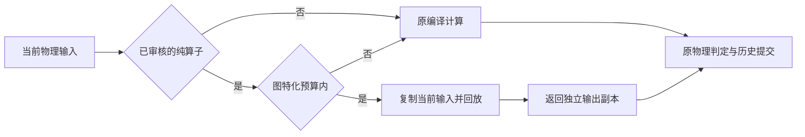

# 有界 CUDA Graph 推理

新增可选 `--execution-policy fused_graph`。它继承 `fused_device`，使用有界 CUDA Graph 编译部分纯物理算子，减少 CPU 逐算子发射开销。默认仍为 `reference`；权重、648 维共享主干、三子步、每子步两轮解析预测加一次网络校正均保留。W1 的自适应细分与原来的物理检查继续执行。

网络仍为 FP32，物理仍为 FP64；没有训练更新或原生 VBD/Featherstone 回退。本策略同样允许普通 GPU 并行归约，因此不保证逐位复现或完整轨迹数值等价。

## 代码与缓存边界

- [cuda_graph.py](../src/wp_vbd/cuda_graph.py) 只处理明确列入清单的纯算子，包括稀疏度量作用、正交化、关节运动列、候选能量及部分运动/有限性计算。碰撞查询、神经网络与 CPU 侧物理接受决策没有被整体捕获。
- 每个函数/编译模式最多八个图特化，总共最多保留 64 个函数/模式项。图编译使用独立代码对象，避免占用原编译算子的 Dynamo 缓存。
- 达到特化上限时，只对这个纯算子使用当前输入的原编译计算；不重试整个物理步，不调用传统动力学求解器，也不跳过检查。仅处理明确的特化上限异常，其他数值、几何、CUDA 和编译错误仍然抛出。
- 每次复制当前输入到图缓冲区，并在返回前克隆输出。下一次图回放不能覆盖仍在使用的状态、度量、历史和诊断。没有复用旧接触或旧物理系数来替代当前计算。
- 库判断不能捕获的计算仍可使用其编译计算路径。缓存项数量不能解读为实际成功捕获的图数量。上述限制控制缓存数量，实际字节占用仍依赖资产规模，并由已有进程预算监测。
- [compiled_contact.py](../src/wp_vbd/compiled_contact.py) 负责分派；[inference_policy.py](../src/wp_vbd/inference_policy.py) 负责作用域。嵌套调用、异常与梯度开启的训练路径均恢复原设置。CLI 使用独立进程，仍不支持同一进程并发运行不受控的训练线程。



## 验证

最初未限制特化的图原型，在保持短窗中较快，但完整 Franka 流程四帧后达到 32 项编译上限而失败。该失败保留，没有作为有效完整回放使用。修正版改为独立代码对象和有界特化，并在超限后保持原算子计算。

GPU 检查使用实际稀疏度量和原来的两遍正交化，覆盖接触行数、粗空间列数、索引重排、移动性修改、重复 owner、空关系、非有限状态更新以及输出存活。还故意降低缓存预算触发后续计算，验证结果、秩与配置恢复；总函数项数限制也单独触发检查。正式模块的这些检查已通过，CPU 侧嵌套/异常/训练设置恢复检查也通过。

```bash
CUDA_VISIBLE_DEVICES='' .venv/bin/python scripts/verify_inference_settings.py \
  --report .local/my_graph_settings.json

TORCHINDUCTOR_CACHE_DIR="$PWD/.local/p0/torchinductor" \
  .venv/bin/python scripts/verify_cuda_graph_inference.py \
  --report .local/my_graph_checks.json
```

有界原型已完成完整 Franka、单角抓布与 W1 装袋，均零重试、通过原任务检查。抓布展开宽度比为 0.6191，原门槛仍为 0.55。正式 CLI 的完整 Franka 与接入后交错测时也已通过：270 帧、810 次网络调用、零重试；保持阶段整块软体最低离桌约 113 mm，最大夹爪/软体表面重叠约 0.117 mm，体积比在 0.637～1.039。正式 CLI 的完整抓布/W1 没有另做重跑，不能把原型验证混写为它们的正式入口验证。其余三个场景尚未做完整图路径验收。

## 性能范围

后续 v30 复核发现，本页 Franka 保持帧脚本每个物理子步调用了控制器，而正式 demo 每三子步调用一次。因此下表和 2.25 FPS 属于旧测试频率；不能当成正式保持帧的精确 FPS。完整 270 帧的正式录制不受这个脚本问题影响。新版测试已修正频率，并重新交错比较。

七样本交错测时如下；每样本三个真实物理步、三次网络调用。Franka 使用接入后的正式入口，包括保持阶段控制器、关节读出和内存记录；抓布和 W1 使用有界原型，为保持状态的求解器短窗。原型与正式实现采用同一个纯算子算法，验证范围仍分别标记。

| 测试 | fused_device 秒 | 有界图秒 | 耗时降低 |
|---|---:|---:|---:|
| Franka 保持帧循环，正式入口 | 0.5181 | 0.4448 | 14.2% |
| 抓布求解器短窗 | 0.4905 | 0.4214 | 14.1% |
| W1 装袋求解器短窗 | 0.6743 | 0.5748 | 14.8% |

三组短窗数值检查均通过。不能把不同轮次的百分比相乘，或用历史完整 FPS 比值推断受控加速。

正式 Franka 的保持段热运行约 2.25 FPS；完整计时段 270 帧 / 224.5 秒，约 1.20 FPS。这两种口径不能混用，均未达到实时。

图编译首次预热更慢：本轮原型三组的首次三个物理步分别约 40 / 67 / 126 秒，原 `fused_device` 分别约 14 / 11 / 15 秒；使用了已有磁盘编译缓存。这些预热样本不是经过交错控制的启动成本比较。图的热运行收益需要摊销，短 demo 的总耗时可能受初始化影响。

原型完整 Franka 为 270 帧 / 227.7 秒，约 1.19 FPS；完整抓布为 168 帧 / 224.2 秒，约 0.75 FPS；装袋为 288 帧 / 344.2 秒，约 0.84 FPS。这是各 runner 的计时段，包含其内惰性编译、控制与记录，未完整包含前置导入/资产构建，也不包含视频渲染。后台负载、缓存与编译形状不同，不能拿这三组值与历史值作受控比较。没有达到实时。

完整回放、视频、失败证据和原始结果见 [本轮目录](../outputs/inference_speed_v29/README.md)。任务通过与完整严格数值回归分别报告，不把前者视为轨迹数值等价，也不声称连续无穿透。v27 抓布首次与重复运行的外观差异仍保留在其原报告中。

## 使用

```bash
export WP_VBD_NEWTON_ROOT="$PWD/.local/newton_pinned_25298"
export TORCHINDUCTOR_CACHE_DIR="$PWD/.local/p0/torchinductor"

# GPU 开窗。首次需要较长预热；图加速不代表已达到实时。
.venv/bin/python scripts/run_robot_validation.py --scene franka \
  --execution-policy fused_graph --window

# 场景还可选 cloth / w1；不加 --window 时离线推理录制。
.venv/bin/python scripts/run_robot_validation.py --scene w1 \
  --execution-policy fused_graph --output outputs/my_graph_w1 --render

# 七样本保持阶段对照；输出目录必须尚不存在。
.venv/bin/python scripts/benchmark_robot_step.py --case franka \
  --recording outputs/current_weight_demos_20261120/recordings/franka_soft \
  --output .local/my_graph_benchmark --frame-loop --repeats 7 \
  --variants reference fused_device fused_graph
```

下一步重点是减少接触形状变化导致的重新编译，并继续降低 CPU 标量等待。可以先研究带有效掩码的接触行容量分组，但必须先验证零权重行、重复 owner、接触历史与实际物理接受的等价性；目前没有用填充关系或删减粗空间列来改写物理计算。
