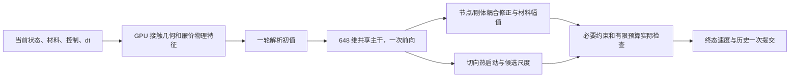

# 哪些物理模块适合由共享网络学习

日期：2026-11-21。本文是源码审计与后续研究设计，尚未实现新网络或训练新权重。当前部署保持已验证的 v24 权重与 v30 执行优化。

## 结论

优先学习从状态、材料与接触条件到位移响应的近似求解映射。当前材料响应的方向、幅值、跨对象耦合和有限预算补偿，仍有大量工作由解析响应完成；它们适合逐步迁移到现有 648 维共享主干。质量、惯量、材料本构、实际碰撞几何和关键自由度约束继续提供明确的物理定义。

这与最初 [v4.1 方案](plans/WorldParticle_VBD_Replacement_Plan_v4.1.md) 的跨类型共享、显式材料参数和物理/网络协同目标一致，但会改变其首版固定物理分支的具体实现。减少正度量投影或改变响应参数化后，旧的正交性、正定性与接受机制结论不能直接沿用，必须重新分析和验证。

## 已核实的实际计算

三例正式录制都启用了 `analytic_predictor_rounds=2`、`unroll=1`、`analytic_elastic_postsolve=True`。实际机器人路径由 `MixedSolver._forward_step` 分派到 [rigid_contact_solver.step](../src/wp_vbd/rigid_contact_solver.py)，不能只检查通用非接触分支。

每个物理子步先构造惯性目标、候选接触与热启动，再执行三个响应阶段：

1. 从当前迭代状态装配残差与冻结正度量，构造局部逆块和关节切空间。
2. 构造材料/机器人运动方向，建立受保护粗空间；仅第三阶段调用共享网络。
3. 应用解析材料补偿，执行步幅、几何、约束与接受检查，再更新内部接触迭代量。

子步结束才恢复终态速度、提交历史并写出状态。三子步不等于只有三次物理响应。

本次对当前 v30 Franka 完整录制的最终状态做了 GPU 短窗诊断，覆盖一个输出帧、三个实际物理步。当前代码确实出现：

| 模块 | 每输出帧调用数 | 说明 |
|---|---:|---|
| 共享主干 | 3 | 每子步一次 |
| 物理残差/正度量装配 | 9 | 每子步三个响应阶段 |
| 机器人/材料粗方向增广 | 9 | 包含材料响应方向筛选 |
| 受保护基构建 | 9 | 使用当前冻结正度量 |
| 解析材料补偿 `correct` | 9 | 网络阶段之外也会执行 |
| `polynomial_basis` | 18 | 当前样本中，方向构造和后置补偿各一套 |
| 接受搜索入口 | 12 | 三次热启动加九次响应；不是每次遍历完整射线预算 |
| 接受量计算 `merit` | 36 | 包含搜索前的当前值及候选计算 |

诊断范围、嵌套时间和检查结果见 [审计摘要](validation/learned_physics_v31.json)。本次只有一个保持状态样本，用于确认实际调用和数量级，不用于发布新 FPS、全程占比或加速倍数。计时受 profiler 影响，区间包含 CPU 发射等待且相互嵌套，不能相加；不能从 Franka 的计数推断 rod/cable 或全部 VBD demo 的耗时。

## 模块替代优先级

| 优先级 | 模块与当前作用 | 建议学习的输出 | 真正需要省去的计算 | 仍保留的部分 |
|---|---|---|---|---|
| P0 | `analytic_material_response.correct`：材料剩余响应 | 有实际幅值的材料位移/模态系数 | 多列度量作用、24 维以上 Gram 装配与谱求解 | 第一阶段保留可解释材料基、最终几何与接受检查 |
| P0 | `elastic_shape_modes.response_columns`：从 24 个候选压缩响应方向 | 从共享 latent 输出耦合材料响应方向与幅值 | 在线小系统求解及重复构基；避免前后各做一套相同工作 | 材料参数、参考几何、刚体运动分离 |
| P0 | 两轮解析预测的剩余作用 | 从一轮解析初值预测剩余跨对象修正 | 删除整轮重复装配、粗空间、材料补偿与候选检查 | 保留一轮明确预算的解析初值，外力不重复积分 |
| P1 | `ProtectedCoarse`、`energy_gram`、`inverse_replacement`：全局/局部近似逆 | 共享低秩耦合响应或结构化正定逆作用 | 多列 H 作用、能量正交化和重复小块分解 | 质量尺度、必要零空间/约束；重新建立下降或接受条件 |
| P1 | 接触切向历史与热启动 | 当前接触的切向力初值、修正方向、候选尺度 | 在足够准确时减少内部响应/接受搜索次数 | 实际间距/法向、摩擦系数、Coulomb 上限及历史匹配 |
| P2 | 步幅与时间步建议 | 有界候选尺度、误差/风险估计 | 减少失败尝试与多余缩步 | 最终实际检查；训练必须覆盖相应 dt 与控制时序 |

H 在这里表示当前冻结正度量，并非完整非线性 Hessian。P1 的结构化正定参数化只约束响应形式，不能自动证明带摩擦、有限步长和变化接触的整步稳定。

保留解析的高价值部分包括：重力/外力积分、质量与惯量、SO(3) 姿态更新、材料能量/应力的一阶计算、关节坐标与限位、实际接触几何、摩擦边界、严重反转/过量穿透检查。网络可预测其响应初值，不能只靠预测的“接触安全”标记决定状态有效。仍允许原验收范围内的小穿透，不把连续零穿透设为新的目标。

## 必须同时拆掉的依赖

当前 [InvariantPortResponse.encode](../src/wp_vbd/protected_response.py) 使用已经算出的 `physical` 和 `baseline` 特征；[VectorInverseResponse](../src/wp_vbd/vector_response.py) 还执行粗空间投影、`energy_gram` 和小块求解。因此更换输出头后，如果仍先计算完整逆块、粗空间及 Gram，物理负担依旧存在。

另外，`residual_system(..., linearize=False)` 当前仍调用会同时生成力和局部块的 `elastic_nodes`，部分其他装配也已经发生。未来若采用仅一阶残差作为网络输入，需要真正拆出 force-only/feature-only 路径；只改调用参数不能视为删除了二阶计算。

旧 `ElasticShapeDirectionHead` 即使预测了方向，后面仍会用物理度量投影和解析曲率重新求幅值。新实验应明确训练的是实际响应幅值，并登记部署时被删除的函数和调用次数。只预测方向、把系数求解留在推理端，不能算完成材料补偿替代。

## 建议架构和实施顺序

保留一个跨类型共享主干。对象和关系的材料参数、参考几何、质量惯量、状态、控制、dt、间距/法向、相对速度和有效历史进入条件特征；后续完整替代时可保留一阶残差或廉价局部提议。减少对完整物理逆块、Gram 与精确粗空间结果的输入依赖。不同对象复用权重，类型输出维度按 DOF 适配，不能为每个 demo 换一套网络。

这是目标流程，不表示已经实现。

1. **独立替换最终网络阶段的材料补偿。** 用现有主干 latent 加对象/材料 readout，监督当前解析补偿产生的实际位移。先保留两轮解析预测作为稳定对照。该阶段仅替换三次 `correct` 中的一次/子步，另两次仍在；不能宣传为全部材料计算已经移除。构基及投影的余留成本单列。
2. **联合蒸馏少一轮解析响应。** 训练 A1+N1；一次网络输出同时承担材料幅值和跨对象剩余更新。网络调用前的第二套昂贵输入装配也要减少。单纯删掉一轮或让旧权重直接承受缺失物理，不是有效实验。
3. **替换精确粗空间/近似逆的昂贵部分。** 通过学习模态响应、低秩作用和质量尺度归一化，逐步减少在线 H 投影与 Gram 求解。此阶段需改变部分网络输入和输出契约，应使用新的架构标识及权重，不改写已验证 v24 权重的含义。
4. **再做步长补偿。** 小步教师可以产生大步标签，但相同物理区间内的控制、外力和历史必须对应；不同时强迫小步聚合轨迹与另一套大步离散残差精确为零。先稳定三子步预算，再验证更少子步；与粗空间替代分开消融。

这些 readout 尽量共用一次主干前向，不能为每个物理模块额外跑一次 46.9M 网络。学习切向热启动时，力和冲量需明确单位及 dt 换算；不能重复添加已解析计算的接触冲量。机器人 IK/控制仍供应驱动目标，本项研究不声称学习了抓取策略。

## 数据、损失与验收

- 现有完整 demo/混合对象数据继续使用，但需补充学生当前状态处的模块级教师标签和少解析轮数展开。仅有最终轨迹、没有相应接触/材料历史的帧，不能随意补零重建训练状态。
- 解析材料补偿和充分计算的参考响应可离线产生标签，纯 VBD 数据提供独立动力学参考。部署不查询这些教师，不构造完整 VBD/Featherstone 回退。
- 主损失监督实际位移/速度及短程滚动结果，按质量、长度、dt、对象类型归一化；对耦合对象共同监督。模态系数不是唯一物理表示，不能只用系数 MSE 或余弦相似度代替位移/做功效果。
- 解析能量/残差作为辅助验证，加入体积/面积/拉伸、严重重叠、接触滑移和速度稳定性指标。材料响应在匹配的载荷测试下检查，避免通过冻结运动或隐藏材料参数获得低 loss。
- 数据按完整资产、材料区间和运动组合划分，保留材料变化、未见接触组合与多步滚动测试；不把相邻帧随机拆分当泛化证据。
- 对照至少包括当前 A2+N1、同预算关闭学习、学习材料补偿、A1+N1 联合模型，固定资产、参数、控制、精度、检测预算与原验收门槛。损失进入平台后看滚动和任务结果，不靠持续追加训练轮数掩盖缺失的结构或标签。
- 第一阶段在 Franka 软块、抓布和 W1 装袋上检查离桌/保持、袋内包含、展开外观、体积和明显穿透，并报告完整 FPS、首次编译、显存及实际模块调用数。然后扩展其余三个机器人场景和全部纯 VBD demo；本次审计没有证明全类型都已被新模块覆盖。

本轮只完成代码发布、源码审计与一个 GPU 短窗诊断，没有开始上述替代实现、生成新训练数据或训练新权重。先用材料补偿的受控替代证明网络确实减少了在线求解工作，再扩大替代范围。
