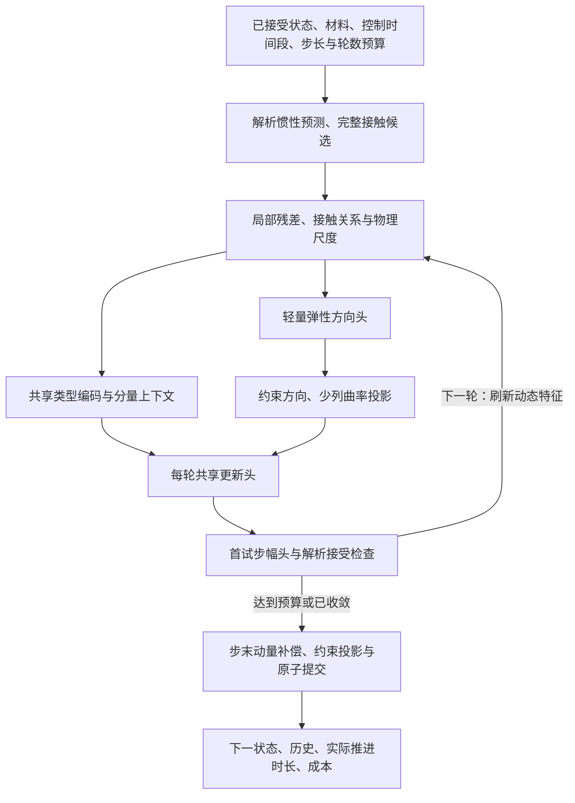

> 2026-11-19：新的解析预测＋共享大网络补偿路径见 [analytic_predictor_corrector.md](analytic_predictor_corrector.md)。本文保留历史试验；独立学习弹性方向的采集、预训练和审计入口已退役，部分中间权重已清理。

> 最终有效配置与 Franka/W1 结果见 [当前 v24 修改总结](current_working_changes_v24.md)。一次性探针已退役，本文保留其历史结论，不再作为运行入口。

# 多步长训练与物理计算替换设计

## 下一版求解器设计

目标是在可计量的计算预算内，用同一权重推进刚体、关节机器人、软体、布料和 cable/rod 的耦合动力学，让输入材料和控制产生相应的运动、受力传递和形变。教师提供细时间步演化，学生在推理预算内学习一次时间推进。下面是候选契约，后文保留已完成试训的记录。

### Loss 对应物体怎么动、怎么变形、怎么相互作用

当前试训的 loss 仍然主要奖励追踪教师点位，另外叠加一组分项。每点位置包含整体位移和局部形变，每点速度与物体线动量又重复计入整体运动；一个全场最大接触深度只会给最深候选传梯度，缺少对“夹住以后带起来”和“释放以后脱离”的监督。Franka 固定窗对照与梯度差异说明，仅调整这些分项权重不足以明确学习任务。

设学生用实际预算自主推进至 `t₁ … tₙ`，`hᵢ = tᵢ − tᵢ₋₁`，`T = Σhᵢ`。窗口主目标为

```text
L_roll = Σᵢ (hᵢ/T) × [L_motion(i) + λ_shape L_shape(i) + λ_contact L_contact(i)]
         + λ_end L_motion(n)
L_train = L_roll + λ_consistency L_consistency + λ_module L_module
```

权重在固定物理单位和误差容差确定后，通过分项梯度标定。每项用带固定物理尺度下限的稳健误差，先按质量、面积、体积或杆段长度在对象内汇总，再按对象、材料族和接触阶段汇总。关节链按有物理意义的链和末端分组，机械臂链节数不应压过小软块。训练窗口以物理时间加权，使有更多子步的窗口不会只因样本点更多就得到更大权重。验证同时保留各项绝对误差、尾部误差和任务结果。

| 项 | 学习信号 |
| --- | --- |
| `L_motion` 整体运动和动量 | 监督质心位移、刚体的 SO(3) 转角、有关节机器人的关节与末端相对姿态，以及末端线动量和角动量。角动量以物体质心为参考，使用世界惯量和粒子杠杆臂。需要约束柔体内部速度时，只增加扣除整体刚体运动后的局部速度。 |
| `L_shape` 局部形变 | 从相对形状提取应变和弯扭，避免整体平移或旋转再计入形变。软体用四面体应变和体积变化，布料用面内拉伸/剪切与二面角，rod 用截面坐标系中的拉伸、剪切、弯曲和扭转。对接触局部和最差一小部分单元单列误差，避免全对象均值掩盖明显扭折或体积塌陷。用同资产、同控制的材料对照检查刚度与摩擦响应。 |
| `L_contact` 载荷传递和接触事件 | 按接触对象与阶段配对。对超过该接触类型容差的法向穿透做单边处罚，汇总持续时间和深度尾部。接触承载时比较参考可辨识的切向相对运动与传递冲量，允许低摩擦真实滑移。跨网格用物体对或接触片聚合，避免按碰撞行编号匹配。释放阶段检查脱离和错误粘连。冲量缺少可信标签时，使用受载物体的质心和相对运动，避免给不可辨识的单接触力伪造标签。 |
| `L_consistency` 时间组合 | 对同一初态、控制和光滑时间段，对比一次大步与两次小步到同一终点的运动、动量和形变。两条轨迹均受教师结果约束，内存和速度历史各自提交。冲击、释放、控制跳变附近按事件窗口监督，不强制两种离散对耗散完全一致。 |
| `L_module` 局部替换 | 仅在各子模块校准时使用。监督候选的有效残差下降、可接受档位或经曲率验证的响应方向。部署动作质量由自主 rollout 主目标负责。旧求解器的修复位移和回溯次数只提供诊断或热启动标签。 |

形变观测对整体旋转不敏感。任务需要柔体的空间朝向和位置时，额外监督固定在材料坐标中的少量点、面法向或接触片相对姿态。例如布面需要托住载荷，纸袋的开口需要朝向方块。根据可信程度对这些观测使用容差。

以 Franka 软块为例，夹指抬起时，质心、线动量和腕部相对位姿监督软块有没有被带起，局部应变和体积监督手指附近有没有合理压缩，接触项监督夹持期间的滑移以及释放后能否脱离。软块绕手指转一个不同的小角度，只要任务与物理观测合理，就不必逐顶点拉回教师轨迹。选权重时逐项看固定测试和完整任务，合计 loss 只用于优化。

跨物体的成对内部冲量采用反向作用，力矩按实际作用臂传递，固定自由度与理想约束沿合法方向更新。无外部冲量时检查整个自由交互分量的线角动量，有接地、驱动或阻尼时纳入相应外部交换。全局能量只在外力功和耗散已知的场景用于独立校验。教师细步轨迹对应的大步状态也不需要把单次大步 Euler 残差压到零。

### 小步教师、连续步长学生和运行时调度

- **训练数据**沿用各 Newton demo 经验证的参考步长与采样节奏，不要求场景统一时间网格。保留每个参考步的位姿、步末线角速度、动作输入、内部历史和接触阶段。用同一轨迹构造可精确对齐的长跨度终点，优先覆盖推理目标 `1/60 s`、`1/30 s` 和不同大小的子步组合，并在同一自主窗口混合。若参考网格无法精确表达目标跨度，优先用该场景可精确组成的邻近跨度；只有关键验证确有必要时才局部补采。连续控制和规定运动保留完整区间记录，不因教师每次更新命令而拆分学生推进。几何删除等离散拓扑事件单独处理。持续外力保留时间序列，积分为对应冲量和必要的时间一阶矩，力矩使用一致参考点。控制的时间语义与部署一致。
- **网络接口**同一权重接收任意正的有限 `h`，显式输入 `log(h/h_ref)`、`h/h_prev`、剩余轮数和与局部刚度、质量、阻尼、接触运动范围有关的无量纲特征。自由飞行和已知外力由解析预测推进，网络预测有限预算缺少的位姿修正与线角冲量。接受位姿与末端速度分别表达，末端速度进入下一步，区间位移速度仅作为时间平均量。现有速度头只会按标量缩放已有速度差，方向不足时用受约束的向量或冲量输出。持续力的补偿随 `h → 0` 衰减，真实撞击的离散冲量单独处理。
- **部署接口**同一模型接收任意正有限时间步。产品默认请求 `1/60 s` 或 `1/30 s`，模型直接处理这两个已设计步长。更长区间按已知控制事件或调度器预算拆分。调度器结合最快相对运动、剩余几何包络、当前接触和材料响应、输入事件及校准误差提出实际子步；平稳段保持 `1/30 s`，快速接触和高形变风险段缩小子步。每一步都检查真实几何与更新质量，拆分和重试计入预算。权重训练范围、测试范围和运行时有效范围分别登记，不能把任意正有限数学输入等同于任意大的单步都准确。

### 三轮预算和学习子模块

推理对 `1/60 s` 使用至多三轮。对 `1/30 s` 先比较一个宏步三轮与两个 `1/60 s` 步、各自最多三轮的完整耗时与任务质量。采用误差与资源共同决定的调度器，优先在可通过的情况下用一个宏步；接触或变形风险升高时，拆成两个半步，必要时进一步细分。总预算按已推进物理时间报告每帧宏步数、物理轮数和共享网络调用数。训练覆盖一到三轮，使模型学会有限预算补偿，再判断是否有理由降到两轮或一轮。轮次消融先保留当前物理与共享主干布局，比较每轮刷新主干和每物理步一次全局编码、轮内轻量更新。编码复用只包括静态特征和仍然适用的全局上下文，局部残差、姿态和接触几何每轮刷新，接触图变化触发重新编码。

1. **回溯初始步幅头。** 轻量读出预测最有可能合格的档位，使用残差、曲率摘要、间隙、上一轮接受值和 `h`。解析检查仍验证实际提议，失败才走同预算的备选档。用上一次接受步幅及解析曲率估计作为对照，比较调用次数、最终步幅、残差和物理任务。即使候选合格，持续选过小步导致冻结也要记为退化。
2. **弹性粗空间方向头。** 低成本局部编码在重型粗空间构造之前，预测物体系 24 个基上的系数，合成为一到两列受约束的形变方向。解析侧去除刚体和禁用自由度分量，随后只对预测列计算物理曲率和投影响应。用旧算法生成的合成位移和受载区域响应做预训练标签，最终以同预算 rollout 和解析残差下降衡量。对照组将原算法的重复 Gram 分解合并，再比较学习替换节省的实际时间。
3. **接触柔度、切向冲量和局部预条件器。** 若分场景画像显示显著成本，可学习范围有界、非负的柔度或正定逆块，预测的切向冲量投影到摩擦锥。碰撞候选、接触间隙、关节约束、软体定向以及最终残差仍由相应几何或物理接口核对。

实现顺序为先确定观测和归一尺度，重建小步到大步的输入与速度接口，然后按一到三轮训练共享响应和终点动量补偿。回溯、形变粗空间各自接入同一基准做消融，确定有收益的组合后再统一训练。固定验证至少分自由运动、即将接触、持续承载和释放四阶段，并包含未见步长、材料、动作和状态扰动。比较同预算解析分支、当前混合模型、新模块和原生 VBD 的轨迹行为与端到端耗时。

### 网络与步进入口

以现有 `MixedSolver` 作为调用入口，保留 Newton 的资产、几何查询和状态适配。训练调用与在线推理共用一次物理步进。调度器、训练采样和 demo 显示分别调用这一步。



| 接口 | 调用与数据契约 |
| --- | --- |
| `advance(scene, accepted_state, controls, step_request)` | 调度入口。接收请求推进时长、起始物理时刻与预算。返回新状态、实际推进时长、子步与轮数计数、重试原因。训练固定步长窗口可直接调用同一个 `try_step`。 |
| `try_step(scene, state, control_span, h, max_rounds)` | 执行一次候选物理推进。输入含上次实际接受的 `h_prev`、已提交的关节/材料/接触历史与本段因果控制。输出候选状态、接触与约束诊断、每个模块计数。只有接受后才提交位姿、速度、历史和时钟。失败重试从相同的已接受状态开始。 |
| 共享编码与轮内读出 | 保留 648 维主干作为可热启动基准。实体语义用粒子、刚体、杆段与关系图表达。显式时间和计算预算送进数值条件，材料与几何维持自己的条件输入。输出按实体或交互分量提供有界的平移、转角更新。预测方向使用局部坐标系和向量特征，整体换坐标系后输出应按同样方式变换。 |
| 弹性方向头与步幅头 | 方向头只读取曲率投影之前已有的局部材料、残差和接触载荷摘要，输出一到两列的基系数，避免依赖已完成的粗空间计算。步幅头在更新方向形成后才读取方向、剩余运动包络和历史步幅。两个头复用可用特征，无需额外跑一遍完整主干。 |
| 步末动量头 | 分别预测自由度的线角冲量补偿。以同一解析步的动量作为基准，学习漏掉的净响应。接触分量成对施加线冲量和相应力矩，再投影理想关节与固定自由度。最终由动量和惯量恢复速度。已有接触与驱动冲量只记一次，训练也对同一基准计算补偿标签。 |
| `observe_rollout` | 按相同的观测定义提取预测与教师的物理量。使用有效标记处理缺失监督，返回按对象和阶段的分项，以及有物理单位的验证指标。模型前向不读取 `observe_rollout` 的教师字段。 |

轮内数值状态包含临时对偶量、当前候选位置、上次接受步幅以及接触快照代次。历史状态包含材料记忆、绕转角和被承认的跨步接触记忆。改变 `h` 后按物理单位重算依赖步长的数值预条件与乘子，保留真实材料记忆。接触冲量初值以锚点、接触法向和材料状态匹配，只复用仍有效的接触，变化的接触从当前解析初值启动。

首轮以固定的 `K∈{1,2,3}` 做同时间跨度消融。后续才启用提前停止，同时检查约束、尺度化未平衡量和实际更新幅度。一个小更新可能意味着线搜索压住了提议，必须区别于收敛。大步造成的时间离散误差用独立的步长验证校准，求解残差只反映当前离散方程的进展。

### 准备数据时的字段和采样约定

先冻结细步原始记录的接口。多跨度窗口由原记录在线索引构造，训练时可改步长分布或展开预算，无需为每个步长另存一套轨迹。

| 记录组 | 必需信息 |
| --- | --- |
| 场景和版本 | 固定 Newton 版本与求解设置、资产与材料参数、单位和坐标约定、实体类型、对象/关节链 ID、拓扑和静止几何、质量与惯量。每条轨迹注明初始条件、动作和材料组。旧 rod 的参考坐标和刚体 COM 坐标在适配层明确转换。 |
| 每个采样点 | 时间点、位置、四元数、末端线角速度、可动/规定自由度掩码、可重启的材料与关节历史。保留完整时间序列和阶段标签。 |
| 每个细步区间 | 控制命令的生效起止、持有或插值规则、运动边界位姿及其速度、外力与外力矩。把命令的时间语义与目标状态分开记录。 |
| 交互与任务观测 | 接触对象对或稳定接触片、接触类型、间隙和相对切向位移。能从教师直接取得并审计的冲量可附加有效标记。几何形变、物体质心和夹持/落地/释放等观测能从状态和控制可靠重建时，可记录计算定义而不重复存储。 |
| 可选子模块标签 | 同一提议下的步幅档位、接受原因、候选位移和算子次数，以及解析弹性投影后的合成位移、残差和曲率。单独记录来源，可从旧求解路径离线追加。 |

数据逐 demo 使用原始参考网格，并在清单中记录其时间步、控制频率和可精确组成的跨度。训练与验证主要覆盖 `1/60 s` 和 `1/30 s`，同时保留各场景可表达的邻近跨度和非均匀组合，例如 `1/60 + 1/30 + 1/60 s`。不把插值生成的终点当作教师状态。留出 `1/30 s` 训练时未采样的时间分区与控制阶段做独立测试。只有当参考质量或网格对齐妨碍关键验收时，才为相关场景局部补采。

准备顺序为纯 VBD 的自由运动与刚体接触、Franka 夹持和释放、软体参数变化、布料自接触、cable 弯扭，再补至少一个跨类型混合场景。W1 装袋严格用于完整跨资产验证，场景、原始记录、保存的推理轨迹和派生标签均不得进入训练集。训练、开发和测试按完整轨迹、动作与材料配置划分。新增困难窗要覆盖接近、冲击、持续承载、滑移和脱离。回放旧纯 VBD 范围时，分别统计 `1/60 s` 与 `1/30 s` 的覆盖，并注明参考步长与目标跨度对齐方式。

首批数据先交付少量完整轨迹和随附清单。每项包含路径与校验值、场景/动作/材料分组、数据划分、教师时间网格、阶段区间、观测有效性及可用跨度。验收时从任意记录状态独立重启一小段，核对控制生效时刻、线角速度约定及材料历史；在自由飞行或已知外载夹具中核对冲量积分，在有接触的窗口核对接触标签与状态时间戳。拒绝跨无效历史或端点无法对齐的样本，普通控制变化保留在学生宏步的输入区间内。通过后再生成同类更多变体，避免批量采集后发现速度或控制时间标错。

### 本次一并确定的优化

1. **减少解析重复计算。** 先把弹性基的 24 个右端合用一次刚体 Gram 分解，作为解析对照。物理组装与回溯复用同一候选的中间量时，键包括候选位姿、接触快照、临时对偶、步长和冻结量代次。状态或摩擦对偶发生改变的计算要刷新。比较复用前后的候选选择、接触力、历史和误差。
2. **缓存静态特征，按交互分量刷新动态特征。** 材料、拓扑、静止基及固定索引映射可按资产与版本复用。第一版对比每轮编码与每步一次全局编码。更新后的接触关系和局部残差每轮读取。非局部向量传递可以改用结构邻接、接触端口和分量 token，先验证远端形变与载荷传递，随后才考虑缩小 648 维主干或调整低秩预算。
3. **减少 GPU 同步与诊断开销。** 批量处理可独立的接触与分量行，在设备上累积计数、接受标记和少量标量。详细逐轮、逐候选记录仅在诊断开启时导出。端到端计时覆盖碰撞、解析算子、学习模块、检查和状态提交，渲染另计。
4. **把阶段采样与梯度校准纳入训练接口。** 采样轴为对象族、接触阶段和物理步长。保留更新前的分项梯度和共享主干梯度，用固定窗口校准权重，放大低误差项时使用物理误差下限。先用少量样本检查冻结残差反向给出的方向是否实际降低损失，再扩大课程。单独报告被约束层截断的更新、重新尝试的次数及拒绝前状态。

代码落地从一次推进的请求与事务入口开始，再接观测与教师数据适配，之后挂载共享步末动量头和两种可单独切换的物理学习子模块。用相同资产和控制将三轮纯解析、三轮共享学习、学习回溯、学习弹性方向逐一对照。先验证 loss 对已知扰动有正确梯度，再看短窗和完整任务，最后按实测物理秒墙钟成本选择模块组合。当前这部分为架构与数据契约设计。

当前代码入口已经固定为四部分：`ElasticShapeDirectionHead` 在受保护响应中生成材料方向，`AdaptiveStepper` 负责接受状态上的变长步推进，`prepare_multirate_data.py` 读取各 demo 原始参考网格并生成可对齐窗口清单，`multirate_data.py` 复用 legacy、rigid、joint、surface、self、mixed、rod 和 elastic-rod 适配器。学习型回溯步幅与接触柔度/预条件器没有接入本轮代码。

当前方向头在每个物体系的 24 列基中预测系数，同一交互分量合成为一列，再经过受保护投影和真实曲率检查。解析对照对 24 个右端共用一次刚体 Gram 分解。方向头通过 `learned_elastic_shape_direction` 配置启用，旧检查点默认路径保持关闭；正式训练入口会创建并训练该头。速度修正头沿用前一轮已完成的 loss/末端速度设计。

### 2026-11-18 弹性方向审计与下一轮校准

`scripts/audit_elastic_direction.py` 在真实开发 rollout 中，固定每轮的物理状态、残差、曲率与刚体/关节投影，比较当前方向、去掉残差先验的学习方向，以及基上的残差投影方向。只额外评估教师，不更新权重。参考结果保存在 `.local/multirate_20261118_v1/review_next/`。本次检查点为 `direction_retrain_v4/step_000100.pt`，每类只有一个开发窗、三个 `1/60 s` 步、每步三轮；这不是完整任务或独立材料的泛化验证。

| 开发窗口 | 当前合成方向回收率 | 去掉先验的学习方向 | 基上残差方向 |
| --- | ---: | ---: | ---: |
| Franka 软块 | 39.26% | 33.17% | 77.88% |
| 悬挂软体 | 0.46% | 0.86% | 64.44% |
| 布料弯曲 | 4.21% | 1.04% | 12.65% |

表内是按可达响应工作量加权的平均值。分母是在同一对象的 24 维候选空间经真实保护投影后的可达最优工作量；它不是总系统物理误差。多对象单独审计不代表它们合成后的最终更新。这个结果表明当前学习方向未能恢复可达的弹性响应，但不能把 W1 全部退化都归因于方向头：旧视频四轮、新视频三轮，共享主干和末端速度也发生过变化。

本轮代码将系数余弦监督替换为物理能量恢复监督，配置标记为 `elastic_shape_objective_version=projected_energy_v1`。令 `B` 为经保护投影的形变基、`r_eff=r+H u_local` 为加入弹性方向之前的剩余残差，则

```text
G = Bᵀ H B,  g = Bᵀ r_eff
W* = gᵀ G⁺ g
L_direction = 1 - (dᵀ r_eff)² / [(dᵀ H d) W*]
```

物理标签冻结；预测方向保留梯度。多物体共享一个标量步时，教师的候选空间联合构造，保留材料对象之间的交叉曲率。零负载不产生标签，有可达负载但预测零方向记为失败。方向反号、缩放、等价基变换不应改变目标。24 列教师计算仅在训练和显式审计执行，推理不计算这部分；方向仍由网络预测，运行时只对预测列计算曲率和接受检查。本目标只是局部子模块监督，不能替代 rollout 的形变、运动、动量和接触目标。

`--trainable-scope elastic-direction` 已支持只更新弹性头、冻结共享主干和末端速度。三类真实训练窗口已完成这种配置下的反向预检，未更新权重；采样观察到进程显存约 1.7 GiB。后续顺序为：

1. 用固定的非 W1 受载窗口短程校准弹性头，单列物理回收率和 rollout 形变误差，检查移除残差先验后仍有收益。保留原有完整优化器检查点，新目标使用独立运行目录。
2. 若短程校准仍受限，补入低成本的材料坐标几何、约束/接触载荷分布和已有局部预条件摘要。仅有归一残差与材料均值不足以确定不同约束下的逆响应。此结构变更必须有新检查点版本，不复用旧输出含义。
3. 对比当前补空间单列与可微的学习粗空间增广：每对象一到两列，联合求解小型投影系统，保留对象之间的耦合。学习列进入保护更新；不能直接插入现有 `no_grad` 的基构造，否则方向梯度会被切断。完整 24 列解析方向只生成训练标签，不作为部署保底方向。此增广结构尚未接入。
4. 在相同步长、相同三轮预算下通过短窗和完整非 W1 任务后，再联合训练主干与速度头约 200 个参数更新。分别验证 `1/60`、`1/30` 及可对齐的邻近步长，报告实际拆步、网络调用和墙钟成本；随后用严格留出的 W1 生成视频验收。

原始 200 步检查点没有记录最早版本的方向头解码语义；不能用当前系数归一公式静默重解释，再宣称复现了旧视频。当前审计脚本对缺少先验版本信息的原始头拒绝执行。正式版本对照前仍需补齐旧解码器或冻结原始源码。

### 传统 VBD 响应数据预训练

先离线预训练弹性方向头，再用自主推进窗口联合微调。以下命令从已有 Newton/VBD 原始轨迹提取监督样本。

```bash
datasets=(franka_block_mu5000_lambda5000_grasp_v310 softbody.example_softbody_hanging/refined_train
          cloth_twist_self_train_default replay_coupled/0 native_mixed_multirate_20261118
          cloth_bending_self_train_default)

WP_VBD_NEWTON_ROOT=.local/newton_pinned_25298 .venv/bin/python scripts/prepare_elastic_direction_data.py \
  --manifest .local/multirate_20261118_v1/macro_data_v3/data_manifest.json \
  --checkpoint .local/multirate_20261118_v1/training/step_000200.pt \
  --output .local/multirate_20261118_v1/direction_pretrain_data/train_300plans.pt \
  --split train --samples 300 --rounds 3 --datasets "${datasets[@]}" --device cuda:0

WP_VBD_NEWTON_ROOT=.local/newton_pinned_25298 .venv/bin/python scripts/prepare_elastic_direction_data.py \
  --manifest .local/multirate_20261118_v1/macro_data_v3/data_manifest.json \
  --checkpoint .local/multirate_20261118_v1/training/step_000200.pt \
  --output .local/multirate_20261118_v1/direction_pretrain_data/validation_100plans.pt \
  --split validation --samples 100 --rounds 3 --datasets "${datasets[@]}" --device cuda:0

.venv/bin/python scripts/pretrain_elastic_direction.py \
  --training-data .local/multirate_20261118_v1/direction_pretrain_data/train_300plans.pt \
  --validation-data .local/multirate_20261118_v1/direction_pretrain_data/validation_100plans.pt \
  --checkpoint .local/multirate_20261118_v1/training/step_000200.pt \
  --output .local/multirate_20261118_v1/direction_pretrain_data/pretrain_500 \
  --updates 500 --batch-size 64 --device cuda:0
```

`--samples` 按轨迹、起始帧和请求步长去重。每个窗口从录制的教师状态出发，用关闭学习响应的项目求解器推进一步，记录三轮解析更新中的对象样本。标签由冻结的 24 维投影曲率 `G`、残差 `g` 和最优工作量 `gᵀG⁺g` 组成。两份数据的起始帧不重叠，部分开发窗口仍来自同一原始轨迹。W1 只用于最终推理验收。

实跑采集覆盖六个数据族，共 1,608 条训练标签和 396 条开发标签。500 次离线更新将开发集的平均恢复率从 2.49% 提高到 50.63%。在已保存的检查点中，第 400 次的工作加权恢复率最高，为 18.32%，同组残差方向对照为 47.31%。以第 400 次权重为起点，完成九个非 W1 数据族上的 200 次联合微调，显存峰值观测为 4,362 MiB。模型只用学习方向，保留投影、曲率和接受检查。

最终权重在 Franka、悬挂软体和布料弯曲三个开发窗上分别以 30、40、50、60 Hz 直接推进三步，共 36 步全部接受。短窗报告为 `review_next/fixed_step_30_40_50_60.json`。W1 从新初态跑完 4.8 秒，60 Hz 出帧，实际步长为 `1/600 s`，共 2,880 步和 8,640 次共享主干调用。方块抬高 0.350 m 并留在袋内，袋体峰值非刚性 RMS 为 1.73 mm，低于可见形变验收阈值。结果保存在 `.local/multirate_20261118_v1/w1_joint200_oblique_60hz_fixed/`。

### 完整抓取的步长审计与下一版优化

Franka 从新初态自主运行完整 4 秒后发现，原 `1/60 s` 夹持失败的一个主要原因是仍使用教师细步的 3 mm 运动包络。项目的碰撞 oracle 限制每步各实体的质心平移加表面旋转半径乘转角；该限制既用于扩展候选集，也用于截断已提议的运动。训练中 `1/60 s` 有 13/76 个宏步目标超出 3 mm，`1/30 s` 有 44/56 个。开发窗另有 5 个超限。正确预测也不能越过这个接受域，因此此前短窗接受、loss 下降不构成完整抓取通过的证据。

同一联合微调 step 200、同一场景/材料/控制，从新初态运行的对照如下。本表没有重新训练，`1/600 s` 的较大变形也不是质量目标。

| 物理步长 | 查询包络 | 每步响应轮 | 4 秒物理步数 | 主干调用数 | 最终质心抬升 | 最小单元体积比 |
| --- | --- | --- | ---: | ---: | ---: | ---: |
| `1/60 s` | 3 mm | 3 | 240 | 720 | 未抬起 | 0.962 |
| `1/60 s` | 12 mm | 3 | 240 | 720 | 8.73 cm | 0.892 |
| `1/600 s` | 3 mm | 3 | 2,400 | 7,200 | 10.01 cm | 0.068 |

`1/60 s`、12 mm 包络的峰值形变 RMS 为 1.05 mm，最大软体接触重叠约 0.31 mm；没有细步对照的局部近塌缩。进一步以 `1/30 s`、12 mm 包络、每步三轮、不拆步运行 4 秒，最终抬升 9.42 cm。这只证明本 Franka 参数下移除错误包络能恢复任务，并非证明 W1 或所有大步都通过。12 mm 不是统一全场景常数：更复杂场景应依据运动范围、控制和碰撞覆盖确定，候选数与计算成本要实测。

已修正并验证的代码：

- `prepare_multirate_motion_budget.py` 按参考真实端点平移和 SO(3) 转角审计，生成显式运动包络的新清单。新 Franka 清单为 `.local/multirate_20261118_v1/macro_data_v3/data_manifest_macro_envelope_v1.json`，训练与开发端点超限均为 0。
- `multirate_data.py` 把 surface 数据行里的 `detection_motion_budget` 同时交给 metadata 和真实碰撞 oracle，重新生成覆盖该范围的候选。只改 metadata 或放开运动检查均不充分。
- 数据索引和正式训练加载阶段拒绝已知的不可达 Franka 宏步标签。原数据和旧清单保留，不能静默截短标签。
- `verify_multirate_motion.py` 检查表面旋转、四元数双覆盖、固定物体排除、旧索引拒绝、新索引通过和实际查询路径。旧 200 次训练的精确源码及原优化器保存在 `joint_finetune_pretrained_v1/implementation_snapshot/` 与 `last.pt`。

下一版的优化按下面顺序落地，避免再次用细分替代大步学习。

1. **部署可达域与长程训练先一致。** 所有目标先通过候选覆盖和运动域审计，保留真实材料、接触与关节检查。Franka 当前 200 次联合训练只有 23 次更新、累计 1.63 秒的采样时间跨度，每窗仅 0.05～0.1 秒，且参考从命令时刻 1.3 秒的夹持姿态开始。下一批轨迹覆盖完整接近、夹紧、承载、滑移、释放和回弹。以 0.1→0.25→0.5 秒延长学生自主展开，监测显存；加入学生发生误差后的状态再由教师生成修正标签，不能每隔几帧重置回教师状态。按完整轨迹、材料和控制划分，W1 一直留出。
2. **保留学习方向主导，扩展空间局部性和列数。** 当前每对象仅将 24 个全局多项式基组合成一列，再把同一交互分量内对象的列相加，共用一个标量。这不足以独立处理夹指压缩、整体受载与远端弯曲。新版本对比每对象 1/2/4 个网络预测列；在静止材料空间建立局部 patch，编码局部变形梯度、约束掩码、接触法向/载荷和局部预条件特征。小型联合 Galerkin 系统保留对象/列之间的曲率交叉项，并接入可微投影增广，不能直接放进现有 `no_grad` 粗空间构造。推理只对预测少量列求真实曲率；完整 24 列解析结果仅做训练教师。这个结构扩展尚未实现。
3. **区分离散方程求解与跨时间段动力学。** 当前能量方向损失训练的是单次隐式离散方程的逆响应；给同一方程更多迭代，也不等价于多次细步的轨迹终点。下一版显式预测区间位姿修正和末端线角冲量；控制输入保留区间初值、末值、持续时间及外载的时间积分/一阶矩。末端速度头要能改变向量方向，当前只缩放已有速度差。对接触冲量施加反向作用、相应力矩和合法自由度投影，学习的有效外载/增量必须进入一致的提议与物理检查，不能在检查后直接挪动状态。增加同终点一次大步/两次半步监督，但不强制冲击附近的离散耗散完全相同。该时间段补偿头尚未实现。
4. **形变目标要同时约束过小和过大。** 保留位姿/动量、体积加权应变与弯曲，同时单列接触区域及最差 5%～10% 单元、相对教师的 log 体积比和严重压缩惩罚。用真实受载/卸载试验监督回弹幅值与相位、静态挠度及不同刚度的响应，避免全局平均掩盖局部压扁。不能以“变形越大越好”定义成功，也不通过调低杨氏模量或降低体积下限美化动画。局部能量恢复只作模块辅助目标，完整自主 rollout 的任务与物理误差决定是否采用。

下一轮验收先固定 `1/60 s`、三轮，跑完整非 W1 抓取与卸载试验；再看 `1/30`、`1/40`、`1/50 s`，单列真实推进次数、候选数、网络调用和耗时。细步作为精度对照，不作为大步通过结果。W1 袋子当前仍未通过形变验收，新的 Franka 包络修正不能替它宣称通过。

### 持续夹持蠕滑与形变的联合优化

`scripts/audit_franka_hold.py` 在实际 hand/link7 材料坐标中计算软块质心的相对下移，去掉机械臂位移和旋转的影响。`1/60 s`、12 mm 包络的抬升阶段相对下移 17.09 mm，保持阶段再下移 5.14 mm；`1/30 s` 分别为 13.96、3.59 mm；细步分别为 6.14、1.01 mm。质心相对位移同时包含真实接触滑移和软体变形，不能把所有位移都当成局部接触点滑移。报告为 `.local/multirate_20261118_v1/review_next/franka_hold_audit.json`。

当时的一次性保持响应探针（现已清理）从修正后的 60 Hz 录制末状态恢复完整位姿、线角速度、关节历史、相同闭合指令，用同一权重继续保持 0.2 秒。只有表内指定的变量发生变化，不使用教师或 native dynamics，不更新权重。

| 短时诊断 | 相对夹爪向下位移 |
| --- | ---: |
| 原摩擦系数 1.5、切向数值支持 8、三轮 | 3.174 mm |
| 摩擦系数 3.0，其余相同 | 3.135 mm |
| 摩擦系数保持 1.5，数值支持改为 32 | 0.517 mm |
| 关闭末端速度头，其余同原设置 | 3.061 mm |

把轮数增至 12 的同状态分支在第一个物理步被接受检查拒绝，不能给出有效滑移改善。上述证据限于同一个已夹持状态和 0.2 秒，不等于完整任务或其它材料的因果保证。报告为 `review_next/franka_hold_response_probes_v2.json`；第一份报告保留了诊断脚本广播错误，不用于结论。

目前的 surface 接触实现每个物理步把 `dual_t` 初始化为零，切向数值系数为 `support_scale/(h² * tangent_delassus)`。大步下少量轮次需要重新建立切向承载，同时留下的相对位移又影响下一步。摩擦系数已为 1.5，翻倍几乎没有消除蠕滑；加强切向数值响应则明显改善，支持优先处理接触状态与有限预算的求解响应。不能从若干行的 `Σ μN` 总和推断可实现的抓取力矩，也不能以全局最大行饱和率判定所有接触均在滑移。

下一版的优先级调整为：

1. **接触承载状态先连续。** 在真实材料/刚体局部坐标中跟踪接触片锚点、法向与接受过的切向状态；几何分离、跨片跳变或真实滑动时正确失效/释放，不允许制造粘连。明确缓存量的力/冲量单位，变步长时一致换算，不能盲目复用旧数值乘子。用学习头预测有限三轮缺少的切向冲量或其初值，保持反向作用和力矩，投影到法向载荷对应的 Coulomb 约束，再通过原来的物理检查。保留 8/32 等数值支持对照，不能靠更大的系数替代这个状态和学习接口。该接触状态/冲量模块尚未接入。
2. **形变和接触输入联动。** 局部 patch、多列弹性方向读取变形梯度、材料参数、夹持法向、切向相对运动和载荷分布。法向挤压改变接触面积和载荷，形变不正确会反过来影响摩擦响应；不能只把位移做成更显著的视觉效果。
3. **预训练加载过程，微调持续保持。** 传统 VBD 数据增加夹紧→持续受载→滑移→卸载回弹的成套轨迹，覆盖低/高摩擦与相同材料下不同载荷/夹紧量。开发集按整条轨迹与配置隔离。loss 同时监督教师的夹爪相对位移、切向相对速度、可辨识的聚合冲量、局部应变、体积变化及回弹，不对真实低摩擦滑动强制零滑移。自主展开必须覆盖 0.5～1 秒保持阶段，失去接触不能用减少穿透 loss 获得奖励。

验收分别报告保持段相对下滑毫米数、毫米/秒、接触有效面积/法向载荷/切向利用率、材料应变与尾部体积比、卸载后的回弹幅值和相位。原生 VBD 参考的本段保持也有少量下移，应按同材质/载荷/控制作对照。静摩擦修复、弹性修复与步长包络修复分别做消融；不能把已修复的“能夹起来”扩展解释为“不下滑、形变正确、W1通过”。

自适应原生入口为 `solver.enable_adaptive_steps(AdaptiveStepConfig(...))`，随后 `solver.step(..., requested_dt)` 接受请求推进时长。调度器根据运动包络限制、控制事件和接受诊断拆步，失败减半，成功后尝试增大；完整请求成功后才提交原生状态和持久历史。计数包含失败尝试的网络轮数，并单独记录已接受子步与重试。W1 的 `--adaptive --request-dt 0.016666666666666666` 和 `--adaptive --request-dt 0.03333333333333333` 分别请求 60 Hz、30 Hz 区间，轨迹的 `physical_time` 使用已提交时钟。最大子步仍受 `--maximum-dt` 限制。当前接口支持独占推进的 mixed/surface/self/elastic-rod 原生求解器；外部耦合调度需要维持自己的时间所有权。

准备数据：

```bash
.venv/bin/python scripts/prepare_multirate_data.py \
  --manifest .local/franka_v310/mixed_course/data_manifest.json \
  --output reports/multirate_course_v1
```

准备好的清单中每个 demo 保留自己的 `reference_dt`、时间戳、连续段、控制事件和长步窗口。训练入口默认读取这份清单，目标窗口来自原始网格可以精确表达的 `1/60 s`、`1/30 s` 邻近跨度。

没有现成数据时，可从采集计划直接运行原生采集、格式校验和窗口索引：

```bash
WP_VBD_NEWTON_ROOT=.local/newton_pinned_25298 .venv/bin/python scripts/prepare_multirate_data.py \
  --collection-plan configs/multirate_collection_example.json \
  --output .local/multirate_course_new
```

计划中的 `commands` 使用脚本路径与参数数组，`{output}` 展开为本次输出目录；每个 job 的 `scene` 声明 dataset ID、loader、数据路径和训练/开发起点。入口自动计算数据与资格报告的 SHA256，生成 `source_manifest.json` 和供训练读取的 `data_manifest.json`。也可同时传 `--manifest` 合并已有数据。示例使用 demo 原有 `1/1200 s` 网格，其他 demo 保留各自设置，不强制 `1/300 s`。原始记录、源版本与资格报告需要一起保留。

准备完成后，训练入口读取生成的清单，热启动旧权重或新架构权重，并可选择一到三轮预算：

```bash
WP_VBD_NEWTON_ROOT=.local/newton_pinned_25298 .venv/bin/python scripts/train_multirate_shared.py \
  --manifest .local/multirate_course_new/data_manifest.json \
  --checkpoint checkpoints/mixed_course/last.pt \
  --output .local/multirate_training_new --rounds 3
```

清单逐窗保存真实起止时间、教师区间时长、学生跨度与请求跨度。原始网格不能精确组成目标时，选已有邻近终点并报告实际跨度，不插值教师标签。连续输入变化不会拆开学生宏步：驱动目标、驱动速度、广义力及外力/外力矩按教师区间实际时长汇总，规定运动边界使用本区间末命令，物理历史给出净运动。该约简是大步积分近似，不能无条件保留任意高频控制的全部时序效应；以隔帧教师终点误差验证，必要时扩展时序编码。caller 反馈目标采样和几何删除属于离散事件，目前仍单独对齐，不能读取未来教师反馈目标。训练按物理时长汇总 loss，从学生预测的历史继续推进。`--horizon` 决定宏步数，连续控制变化不会增加调用；`train_multirate_shared.py --rounds {1,2,3}` 决定每次物理推进的网络轮数。

本轮 CPU 验证通过了材料方向的旋转一致性、去刚体正交性、受保护曲率投影及梯度，非均匀时间网格、连续控制跨步汇总、外力积分和训练/开发窗隔离，以及自适应失败历史回滚。原生 surface 入口连续接受了 `1/60 s`、`1/30 s`，强制失败时输出、历史和时钟均未改变。示例采集入口已完成夹爪 demo 的 360 帧/7200 子步及原始终态检查，生成可训练窗口。多类型 legacy 的两种跨度和混合跨度均完成三跳 rollout/backward，学习方向头梯度非零；夹爪场景的事件拆分窗口也完成多跳反向。验证入口：

```bash
.venv/bin/python scripts/verify_multirate.py --report .local/multirate_checks/contracts.json
```

这些检查验证接口和梯度链路；本轮没有启动正式优化，也没有据此宣称训练质量或端到端加速。部分旧 elastic-rod 数据引用的源 trace 已在清理中移除，需要恢复源记录或从新入口重采；RJ45 SDF-mesh caller 的运行适配器仍要求 CUDA。

## 已完成试训与画像

step 156 是比较基线。当前训练保留共享 648 维主干和显式物理参数，子步内从四轮减至三轮。Franka 的一个 60 Hz 帧在 600 Hz 教师网格上分为 3、3、4 个细步，对应 5、5、6.67 ms 的三次推进。另采样 2、2、2 的短窗。精确均匀的 1/180 秒无法落在这份数据的格点上，需要相容的教师采样网格才能直接监督。额外细分和实际调用数都应计入实测。

## 这轮训练先解决什么

| 已知问题 | 当前处理 | 扩训前证据 |
| --- | --- | --- |
| 位置和姿态主导旧 loss | 每个可动物体先在自己的尺度内求误差，再等权汇总。分别拟合位姿、末端线角速度、物体线动量、材料形变，移除统一的 h⁻⁴ 系数。 | 对固定窗口报告绝对物理误差、总 loss、各分项和梯度。重点检查某一项或少数任务是否支配更新。 |
| 步末速度和区间位移速度混用 | 在接受位姿后，用共享有界速度修正头补偿。初始修正为零，固定自由度保持原值，mimic 修正投影到质量度量切空间。下一步积分读取修正后的速度。 | 自由飞行、制动、夹住与滑落、释放后运动分别核对。速度监督与接触合法性均应通过。 |
| 训练窗口和部署预算不一致 | 从小步数据构造逐跳对齐目标。学生在窗口内自主推进并提交自身历史，控制按原有持有区间传入，外力和外力矩按时间平均。 | 第一个多类型试训仅 Franka 使用多步长；其余场景在原生步长回放。按动画时间逐渐延长，补独立材料和动作，再扩展到现有 42 个纯 VBD demo。 |
| 接触和形变缺少可解释指标 | 软体记录应变、体积比，布料记录面内应变和弯曲，rod 记录拉伸剪切和弯扭。接触候选法向深度和修复监督各自记录。 | 当前深度是候选接触行的法向量，2 mm 是试训阈值。完整验收按接触类型量度持续深度、滑移、抓取保持和释放，材质变化用新动作和参数验证。 |
| 反向近似、保护边界、响应秩的影响未知 | 冻结这些结构选择，先比较固定窗 loss、有效梯度和同物理预算关学习分支的结果。 | 同窗正负方向差分、更新幅度、受保护投影前后的响应量，以及低秩方向覆盖的残差。实际证据决定是否提高秩或改变反向。 |

首轮热启动试训使用了 step 156 权重和新的 AdamW 状态，先前时间步来自 600 Hz 数据上的可对齐较短跨度。这个试训只作为 loss 与架构诊断。正式数据按各 demo 原有参考步长准备，并让学生直接学习 `1/60 s` 和 `1/30 s` 的自主更新。Franka 的同一参考轨迹划分只能用于课程调试，泛化验证要用独立轨迹和控制。

有现成教师数据的工作区可运行以下命令。输出目录保存固定窗口、每次更新的分项指标和周期性检查点。

```bash
WP_VBD_NEWTON_ROOT=.local/newton_pinned_25298 .venv/bin/python -u scripts/train_multirate_shared.py \
  --manifest reports/multirate_course_v1/data_manifest.json \
  --checkpoint checkpoints/mixed_course/last.pt \
  --output .local/multirate_pilot_new --updates 100 --validation-interval 10 --gpu-memory-gib 16
```

下面的 100 步命令用于复现已完成的 loss 诊断，不代表新的步长训练方案。准备新课程时按各 demo 原有参考步长整理数据，再构造目标为 `1/60 s` 和 `1/30 s` 的学生 rollout 窗口。历史上的均匀 `1/180 s` W1 短窗仅用于分析旧权重响应。

## 物理侧优先替换哪里

W1 装袋的 10×4 单帧画像总耗时 8.80 秒，关节树和形变粗空间约 1.13 秒，物理组装约 1.02 秒，接触行约 0.91 秒，merit 评估约 0.89 秒，层次主干约 0.47 秒。3×3 的单帧画像总耗时 1.94 秒，回溯 0.54 秒（含 50 次 merit 评估，占 0.26 秒），物理组装 0.20 秒，粗空间方向生成 0.19 秒（含弹性形变投影 0.10 秒），保护投影 0.13 秒，碰撞查询 0.10 秒，主干 0.10 秒，接触预估 0.04 秒。统计有嵌套，另外还存在未归类开销。3×3 画像来自自己的录制状态初始化后推进一帧，需在 Franka 和自接触场景复测。结果位于 `.local/step_budget_v321/probe/result.json` 和 `.local/multirate_w1_probe_v324/trained/result.json`。

1. **先减少回溯评估。** 在当前响应特征上接轻量输出，根据步长、残差、法向间隙与上一轮反馈预测线搜索初始档位。以同一次试探中的首个合格档、残差下降和实际接受率监督。每次提议仍通过实际几何与能量判断，遇到失败在明确预算内尝试现有候选。另做不加网络的对照，用上次接受步幅或解析曲率预测首档，判断学习是否节省了更多评估。后续可测试预测整体位移或摩擦冲量初值，并将冲量投影进现有接触法向和 Coulomb 上限。
2. **让网络替换弹性粗空间的全候选投影。** 袋子形变模块每轮构造 24 个多项式方向，去除刚体运动，对所有方向作用物理度量，再求小型投影响应，最后只把一列交给共享求解器。可以让轻量输出直接预测 24 个系数或 1～2 个柔性方向，把监督放在合成后的位移方向和残差下降上。保留刚体一致运动和关节约束，把物理度量运算集中到预测的少量列，用现有曲率和路径检查筛选。训练可先使用旧解析投影的方向，再用大步 rollout 校正。解析对照也应把同一 Gram 的多右端统一分解，比较省掉重复线性代数后还剩多少可学习收益。
3. **再考察接触预估和局部预条件器。** 现有预估会求局部逆块、计算每个候选的法向柔度，并评估惯性、局部与对象级预测。可学习每条候选的正法向柔度，或预测一个正定、尺度受控的局部逆作为初值。用少量解析残差和曲率检查决定是否采用。先拆分剖析预测、逆块和几何的成本，确认网络调用可以少做相应的物理计算。

几何候选完整性、实际接触间隙、非翻转检查和理想关节约束继续由明确的物理接口确认。网络可以为碰撞候选排序，但排序应保持保守候选覆盖。基础外力积分和质量惯量项计算较直接，优先级低于每轮重复的投影、接触组装及回溯。

逐个替换模块时固定资产、物理参数、控制、时间步和轮数。比较纯解析、当前混合实现、替换实现的长程任务质量和端到端耗时，并单列该模块节省的物理调用、额外神经前向和进入解析检查的比例。完整测试还应加入同场景原生 VBD，覆盖抓取、放置、柔性变形和接触密集阶段。

## 设计诊断

已完成的 100 次 GPU 试训中，每组各更新 20 次。固定窗的 Franka 两种时间安排分别从 0.314224 到 0.314322、从 0.250937 到 0.252089。训练前关闭所有学习响应的同预算结果分别为 0.306762 和 0.249103。现有结果支持保留分项诊断，Franka 的学习补偿尚未带来稳定改善。Franka 与刚体的更新前梯度范数中位数分别约 1.67 和 0.000076。下一轮设计需要先校准各数据族和接触阶段的梯度幅度，分别检查学习响应与末端速度头的贡献。对几乎已经解对的窗口保留误差下限或用绝对误差报告，避免放大数值噪声。完整试训记录在 `.local/multirate_pilot_v323/training.json`。

历史 W1 诊断使用了均匀 `1/180 s`，三个两帧窗口每帧调用主干九次。它们从已保存的模型状态起算，不代表 `1/60 s` 或 `1/30 s` 验收，也不替代完整装袋任务。

2026-11-18 复查修正：此前把每个原始输入变化都设成学生步边界，导致部分轨迹仍逐教师小步推进。这与大步学习目标不符，已修正。教师记录间隔为 `1/60 s` 时，学生 `1/30 s` 的单次推进监督到索引 `i+2`；教师为 `1/600 s` 时监督到 `i+20`。训练窗口覆盖 `1/60 s`、`1/30 s` 与混合跨度，均按学生自身已接受状态展开。自适应缩步只在推理的检查或误差控制需要时采用，报告真实调用次数。本轮热启动目标为 200 次参数更新，12 GiB 进程显存预算；保留独立 step 200 权重，再比较独立 demo。

## 2026-11-18：局部形变与夹持/卸载试验

新增第二个全局形变列之外的两个可学习局部材料列。局部列在材料坐标系中形成平滑空间窗，投影去除刚体平移和转动，再与全局列一起投影到受保护粗空间的正交补。每个物理交互只解至多三列的正则化 Galerkin 系统；部署不构造完整全局矩阵。训练仍使用实际可达方向的能量恢复监督。loss 增加最差 5% 四面体应变项、对数体积误差和低体积 barrier，以及 Franka 软块相对真实手坐标系的位置/速度误差。

加了有界接触记忆：接受步才保存软接触 shape、角点、重心坐标、法线和切向承载力；下一步用排序特征键匹配，在新切平面重投影并按当前 Coulomb 圆限幅。匹配是一对一，拒绝步不提交，接触消失或释放后缓存会被清空。切向网络只提供首次求解的有界种子，摩擦系数及物理力上限不变。

为观察卸载回弹，增加离线 teacher-only `--release-after/--release-duration`，并用专门资格筛选器检查夹持保持、释放阶段体积正性和回弹。该教师原始 `1/600 s` 时步、100 轮 VBD、末轮镜像约束投影，保持 0.5 秒后张开；教师通过资格后追加至独立 manifest。当前新课程只含 Franka 原轨迹及这条 release teacher，W1 未采作训练数据。

新课程完成 200 次物理头微调，局部形变头和切向接触头均获得非零梯度，进程显存峰值 2.7 GiB。课程固定开发窗平均 loss 改善约 0.2%，release 数据约 0.09%，因此该指标本身不支持质量提升。更关键的是，新权重的独立 `1/60 s` 释放场景在 2.35 秒因所有软体自由度无法找到可接受步而终止，记录到最小四面体体积比 0.011。关闭局部头后运行至 2.67 秒仍失败，最小体积比 0.0108；关闭记忆但保留局部头，在 2.67 秒失败，最小体积比 0.423；同时关闭新增两个头的旧权重完成释放场景并维持最小体积比 0.834。三项模型 60 Hz 场景使用同一控制、摩擦、包络、关节/材料运动模式及三轮预算。可见新分支的推理候选未通过，不应替代旧权重演示。

证据与产物保存在 `.local/multirate_20261118_v2/`：`physics_heads_release_200/` 含权重、loss 图和训练报告；`franka_hold_release_teacher_matched/` 含通过审查的原生教师及释放资格；`review_next/final_inference_audit.json` 和各运行目录记录 60 Hz 失败/消融。新增接触历史、局部列、loss 和兼容验证脚本均通过 CPU 测试；旧 surface/joint 完整验证也通过。此版留下的是安全且可训练的实验接口，当前训练权重没有达到端到端验收。

## 2026-11-19：拒绝步恢复与验收纠正

恢复以完整请求区间为事务：失败提议的位姿、速度和接触历史不提交，先缩短内部推进间隔，最小为 **1/600 秒**。请求或硬事件间隔不能满足最小/最大步长时，在求解前明确报错，不产生更短的尾步。到最小可表示间隔仍失败时，重新查询接触，先在原轮数内关闭学习切向种子，再关闭新增局部弹性列；之后才增加轮数。最后两档为关闭学习响应的解析紧急回退及阻尼回退，属于需单独报告的恢复成本，不是学习模型通过验收的证据。所有候选仍通过相同的有限性、接触深度、速度变化及求解器物理路径检查；有限工作预算耗尽仍会明确失败。

每个候选拥有独立历史副本。恢复后精确恢复配置中原有及原先不存在的键和局部头数；完整请求通过后才发布原生输出、历史和时钟。`adaptive_solver_attempts`、`adaptive_recovery_attempts`、`adaptive_response_rounds` 统计已提交请求中的所有尝试，含失败候选。未完成请求的成本在 `last_diagnostic.adaptive.attempts` 中；`nn_backbone_calls` 和墙钟时间覆盖全部工作。响应轮数包含解析回退，不能直接当成神经前向次数。实际接受步长最小/最大值也单列记录。

恢复验证入口：

```bash
WP_VBD_NEWTON_ROOT=.local/newton_pinned_25298 .venv/bin/python \
  scripts/verify_adaptive_recovery.py \
  --report .local/recovery_checks/contracts.json

WP_VBD_NEWTON_ROOT=.local/newton_pinned_25298 .venv/bin/python \
  scripts/verify_native_adaptive_recovery.py \
  --checkpoint .local/multirate_20261118_v2/physics_heads_release_200/step_000200.pt \
  --output .local/recovery_checks/native_repair --device cpu

WP_VBD_NEWTON_ROOT=.local/newton_pinned_25298 .venv/bin/python \
  scripts/verify_native_adaptive_recovery.py \
  --checkpoint .local/multirate_20261118_v2/physics_heads_release_200/step_000200.pt \
  --output .local/recovery_checks/native_rollback --device cpu --reject-all
```

前者覆盖失败回滚、事件对齐、独立接触/速度/历史有限性拒绝、修复轮数计量、配置恢复和工作预算。后两者在真实 Franka 原生状态和模型路径上注入诊断拒绝，分别验证三轮学习响应重新求解后成功，以及所有档位失败后原生位姿、速度、历史、时钟完全不变。这些是故障注入测试，不作为 demo 或训练轨迹。测试中禁止原生 VBD/Featherstone。

复查还发现独立控制错误：旧 `--release-after` 在释放时刻前也覆盖手指目标，把接近阶段的开爪目标 0.04 m 强制改成闭爪目标。现在只在指定释放时刻到达后覆盖目标，此前保留原有接近、下降、夹取和抬升控制。旧模型 release 录制不能用“完成 4 秒”解释为成功抓取。旧教师从 1.3 秒开始，确实观察到约 11.55 cm 抬升，可按实际存储控制继续用于相应窗口，但与修正后的完整接近控制不相同；后续同动作比较需生成匹配新控制的教师并重新审查，不能混称同一动作。`review_franka_release.py` 额外要求保持阶段实际抬升至少 2 cm，并报告真实抬升，防止只在支撑面上静止也被标为抓取合格。原始数据哈希不做追改。

旧 `.local/multirate_20261118_v2/retest_recovery_ladder_release_60hz` 虽完成 4 秒，但没有触发重试，且实际软块质心最大抬升为零，不能证明拒绝恢复或成功抓取。`audit_franka_hold.py` 现在同时报告实际质心/手部抬升和积分完成状态；视频叠字会明确标出没有抬升的完整序列，避免以运行完成代替任务完成。本轮重测、故障注入和审查保存到 `.local/recovery_20261118_v3/`，不覆盖冻结 step156 或已有 step200 权重，也不在效果审查前继续堆训练轮数。

### 完整 3×3 GPU 验证

本轮使用已有 `physics_heads_release_200/step_000200.pt`，没有新增优化器更新。完整场景从 0 秒独立初始化，3.8 秒开始释放，记录至 4.5 秒。按原成功用例和合格教师明确指定驱动刚度 20000、`grasp_x=0`、夹爪 yaw 为 −π/4、闭合坐标 0.024 m；材料仍为 μ=λ=5000、摩擦 1.5、数值切向支持系数 8。此前使用入口默认驱动刚度 2000、yaw=0 的运行单独保留，不能与原成功用例混为相同参数。

| 指标 | 实测结果 |
| --- | --- |
| 输出帧 / 已接受物理步 / 神经主干调用 | 270 / 810 / 2430，严格为每帧 3 子步 × 3 轮 |
| 物理子步 | 1/180 s；本次没有缩步、拒绝重试或解析应急回退 |
| 动力学设备 / 原生 VBD、Featherstone、教师读取 | CUDA / 均为 0 |
| 最大软块质量质心抬升 | 45.41 mm，保持结束约 43.5 mm，随后按开爪命令落回桌面 |
| 保持阶段 3.3–3.8 s | 0.5 s；质心相对实际手坐标系沿重力方向变化 −0.68 mm，不能解释为下滑 |
| 抬升阶段 2.1–3.3 s | 同一相对质心指标变化 +29.04 mm，混有滑移、变形与抓取形成过程，仍需改善 |
| 非刚体质量 RMS / 最小四面体体积比 | 峰值 8.96 mm / 0.206；记录状态中无反转 |
| 逐帧原生几何复查 | 271 个状态，机器人–软体最大表面重叠约 0.904 mm，刚体表面重叠为 0 |
| 推进墙钟时间 / 实际输出帧率 | 526.6 s / 约 0.51 FPS；视频播放速度不代表推理速度 |

双视角视频为 `.local/recovery_20261118_v3/matched_release_3x3.mp4`，任务筛查为 `matched_task_screen.json`，分阶段实测为 `matched_grasp_audit_phases.json`，几何复查为 `matched_geometry.json`。自动任务和网格筛查通过，可保留为当前 3×3 视觉候选；相比旧 10×4 用例约 10 cm 的抬升，仍有明显跟随滞后和较小抬升，不等于同等效果、实时运行或全 demo 验收。

此次也修正了审查逻辑：`phase[i]` 属于 `[time[i], time[i+1]]`，保持时长应包含最后一个保持区间；抓取漂移以保持阶段的真实手坐标系为参照，不能把初始开爪接近姿态当作已抓住的锚点。后一错误会把原本成功抬升 10 cm 的旧用例误判为漂移 9 cm。修正后，旧成功录像通过，未抬升的默认参数录像仍被拒绝。保持区间和主动开爪释放区间也单独计量。

复现实测场景：

```bash
WP_VBD_NEWTON_ROOT=.local/newton_pinned_25298 .venv/bin/python -u \
  scripts/run_franka_vbd_shared.py \
  --checkpoint .local/multirate_20261118_v2/physics_heads_release_200/step_000200.pt \
  --output .local/franka_3x3_reproduce --device cuda:0 --gpu-memory-gib 12 \
  --frames 270 --substeps 3 --release-after 3.8 --release-duration .15 \
  --arm-drive-ke 20000 --grasp-x 0 --grasp-yaw -0.7853981633974483 \
  --grip-closed .024 --grasp-height .21 --motion-budget .012 \
  --material-motion-modes --articulation-modes --force-aware-anticipation \
  --tangent-support-scale 8 --elastic-local-heads 2 \
  --learned-contact-memory --contact-seed-scale .1
```

下一阶段先用相同资产、参数和完整控制区分共享响应、局部弹性头和切向记忆的贡献。已有 200 次微调只训练弹性和接触头，共享主干与速度头冻结；这不足以证明共享大步补偿已经学好。再设计共享响应与物理头的联合微调，覆盖抓取形成、抬升、保持和释放的自主多步窗口，保留其他纯 VBD 类型回放以检查遗忘。针对目标 3×3 加入对应步长课程；600 Hz 数据可精确组成 3/3/4 细步的帧内安排，均匀 1/180 秒若需直接终点监督，可为该新教师选择兼容参考网格，而不插值接触标签或强制重采全部旧 demo。是否继续减少到 1×3，以独立完整运行的质量和实际总开销决定。
