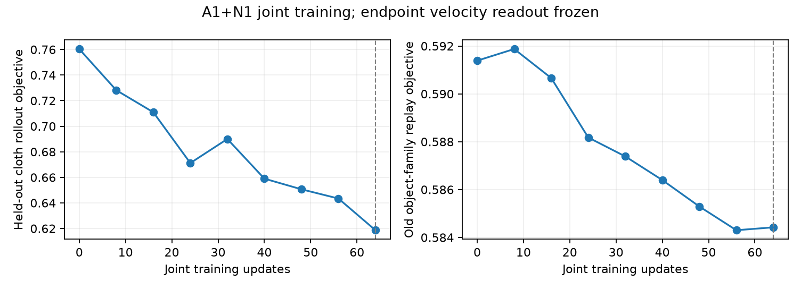

# v32：最终材料补偿消融与 A1+N1 联合训练

本轮保持默认 v24 + v30 推理策略，实验入口显式选择权重与物理预算。目标是判断哪些补偿确实需要网络，再尝试减少完整物理装配轮次。v31 的单模块约 12% 耗时下降不等于整帧加速；不能据此直接推广。

## 对照与判据

| 实验 | 每物理子步 | 最终材料响应 | 权重 |
|---|---|---|---|
| 解析对照 | A2+N1 | 原解析约化求解 | v31 主干与读出头，关闭读出头 |
| v31 | A2+N1 | 共享潜在特征材料读出 | v31 |
| 省略对照 | A2+N1 | 直接省略 | 同一 v31 |
| A1 起点 | A1+N1 | 共享材料读出 | 同一 v31，未针对 A1 微调 |
| A1 联合训练 | A1+N1 | 共享材料读出 | 主干与材料读出共同微调 |

A2/A1 是前置解析响应轮次，N1 是一次主干调用；固定预算场景每显示帧仍为三物理子步。A1 将这类场景每帧响应装配从九次降至六次；W1 的事件切分按实际接受子步计数，每子步由三轮变为两轮。不改变名义子步时长，不能称已经完成大步长训练或实时推理。

`--no-shared-material-correction` 恢复最终解析材料响应；`--omit-final-material-correction` 才是直接省略。两者互斥。省略仅作用于最后的网络阶段，保留前面的解析响应、接触/材料安全检查、历史更新和网络调用。

完整验收使用已有抓软块、单角抓布、W1 装袋的原任务门槛：整体抬起与保持、四面体体积、接触重叠、布宽和法向一致性、实际袋内方块位置和袋子变形。任务通过不能替代逐帧视觉检查，也不能代表所有资产泛化。

## 联合学习

训练损失为原轨迹监督加 `0.03 × L_material`。原轨迹项监督位置、速度、应变、体积、布弯曲和非局部形态等；材料辅助项在学生当前状态上计算解析材料标签，拟合学习增量，而非拟合整个解析前缀。

令前缀提议为 `u`、学习输出为 `u + δθ`、同一状态解析输出为 `u + δA`：

```
L_material = ||δθ - stopgrad(δA)||²_M
             / (||δA||²_M + sum(m) × (length × 1e-6)²)
```

M 采用质量加权平移和质量乘场景长度平方加权转动，是位移监督度量，不宣称精确转动惯量能量。标签在 no_grad 中生成；辅助标签求解另计数，不能混入推理物理求解计数。eval 或 no_grad 不查询此教师。

多步梯度预检发现，材料基内部刚体 Gram 的重复平移特征值会使特征向量导数非有限。现按原解析材料模块的方式冻结几何基线性化，保留前向值以及特征、提议和共享网络的梯度。CPU 四步、两步梯度截断预检已通过；不能只用单步梯度检查覆盖这一问题。

本轮实验冻结末速度读出，更新共享主干与材料读出，避免主要依靠末速度改变来拟合轨迹。仍使用原梯度截断、有限梯度检查和旧对象族回放。开发集只用于选权与平台停止；不以训练总损失代替整段效果。

材料头当前仅作用于 surface/joint v38 场景。其他对象族回放在显式配置 `shared_material_analytic_other_contracts=True` 下保留原解析材料响应，同时继续训练共享主干。统计中单列这些调用；不宣称材料头已经学习全部对象类型。

可用数据包括 300/30 条增广训练/开发轨迹、42 个完整纯 VBD demo 和 6/1 条抓布训练/开发轨迹。**本轮小规模联合试验不等于把全部可用数据重新训练一遍**：实际使用范围以训练记录的 microbatch 数据集 ID 为准，完整官方 demo 的再次混训需在预算实验通过后开展。

## 入口

```bash
# 同一权重、同一场景，省略最终材料补偿
.venv/bin/python scripts/run_robot_validation.py \
  --scene cloth --recipe outputs/material_v31/train_main/recipe.json \
  --omit-final-material-correction --output outputs/my_omit_cloth

# 显式减少前置解析轮次；这条命令本身不构成针对 A1 的训练
.venv/bin/python scripts/run_robot_validation.py \
  --scene cloth --recipe outputs/material_v31/train_main/recipe.json \
  --analytic-predictor-rounds 1 --output outputs/my_a1_cloth

# 主干与材料读出联合微调；出现开发集平台即停止
WP_VBD_NEWTON_ROOT="$PWD/.local/newton_pinned_25298" \
.venv/bin/python scripts/train_robot_cloth_corrector.py \
  --manifest .local/cloth_finetune/data/manifest.json \
  --checkpoint outputs/material_v31/train_main/model.pt \
  --collection .local/analytic_predictor_20261119/augmentation_330/collection.json \
  --replay-manifest .local/analytic_predictor_20261119/pilot_replay.json \
  --analytic-predictor-rounds 1 --material-supervision-weight .03 \
  --freeze-terminal-velocity --updates 64 --hops 12 --truncate 3 \
  --validation-interval 8 --validation-hops 12 --patience 3 \
  --gpu-memory-gib 16 --output outputs/my_joint_a1
```

所有路径指向本机既有数据，不是公开下载数据集。训练保存最佳模型及配套优化器、随机数状态；当前训练入口不提供从该状态继续训练的 CLI，不宣称已经验证精确续训。

受控速度对照在同一保存状态、同一权重、同一 GPU 上交错测量，各组使用 fused_graph，预热后比较。`benchmark_robot_step.py --material-ablation --variants reference material_analytic material_omit prefix_one_learned --frame-loop` 中 reference 为 A2 学习材料响应；保留数值差异诊断，另报完整任务质量，算法不同不要求逐状态一致。保持状态测时不代表完整任务 FPS。

## 本轮训练与对照结果

完成 64 次联合更新，采用第 64 次权重。开发集损失 0.760396 → 0.618654，降低约 18.6%；旧对象族回放 0.591388 → 0.584422。本轮按预算结束，损失仍在下降，不宣称已进入平台。

实际产生梯度的独立轨迹为 72 条：6 条抓布、64 条增广、2 条机器人回放；本轮没有重新混训全部 300 条增广或 42 个官方 demo。47,136,211 个参数参与训练，观测进程显存峰值约 4,324 MiB。已逐张量确认主干与材料头发生更新、末速度读出参数保持不变，优化器更新号与所选模型一致。



同权重、同一 Franka 保持状态，7 个预热后交错样本/组，包含原控制器、关节读出和内存录制：

| 方案 | 每帧中位耗时 | 保持状态帧率 |
|---|---:|---:|
| A2+N1，最终解析材料响应 | 570.60 ms | 1.75 |
| A2+N1，学习材料响应 | 565.88 ms | 1.77 |
| A2+N1，省略最终材料响应 | 563.12 ms | 1.78 |
| A1+N1，学习材料响应 | 455.12 ms | 2.20 |

A1 相对 A2 学习材料响应耗时降低约 19.6%，保持状态帧率提高约 24.3%；7 组配对均更快。直接省略最终材料响应只提高约 0.5%。上述使用同一 **v31 权重**，用于隔离物理预算差异；不等同于 v32 权重整段任务的加速结论。

完整 GPU 抓布形态对照如下；指标并非逐项都改善，不能仅用单个损失或 PASS 判定视觉等价：

| 方案 | 最小晚期布面宽度比例 | 最小晚期法向一致性 | 最大机器人/布重叠 |
|---|---:|---:|---:|
| v31 A2+N1 学习材料响应 | 0.853 | 0.627 | 0.478 mm |
| 同权重 A2+N1 省略最终响应 | 0.649 | 0.624 | 0.382 mm |
| 同权重直接改 A1+N1，未微调 | 0.717 | 0.788 | 0.400 mm |
| v32 联合训练 A1+N1 | 0.883 | 0.700 | 0.325 mm |

三个完整 GPU 任务均已通过原检查，零重试、零推理教师调用、零原生动力学求解器调用。全部使用第 64 次权重，网络和张量物理计算均在 CUDA：

| 任务 | 帧数 / 实际物理子步 | 网络 / 解析材料约化求解次数 | 脚本记录帧率 |
|---|---:|---:|---:|
| Franka 抓软块 | 270 / 810 | 810 / 810 | 1.01 FPS |
| 单角抓布 | 168 / 504 | 504 / 504 | 0.98 FPS |
| W1 装袋 | 288 / 878 | 878 / 878 | 0.90 FPS |

Franka 最小体积比 0.646，最大机器人/软体重叠约 0.292 mm，保持阶段整体桌面净空不低于 0.113 m。W1 最后 37 个保存状态的方块角点均在实际袋壳容差范围内，袋口双侧接触率约 97.8%，袋子可见变形检查通过。已抽查视频时间点截图和末帧，未逐帧人工检查。

同一 v32 权重的完整 Franka 顺序对照：A2 为 347.12 秒，A1 为 268.11 秒，两组任务检查均通过；期间观测到其他目录的 GPU 作业，因此保留原始耗时，不将它作为隔离环境下的整段加速证明。上述“脚本记录帧率”来自各脚本自身 wall_seconds，包含首次计算编译等开销，计时起点存在差别，不能作为跨场景或跨历史运行的公平速度排名。保持状态交错测时也不能替代完整任务速度。这一版尚未实时。

运行结果集中于 `outputs/material_v32/`，视频在 `outputs/material_v32/candidate/videos/`。已核对三个视频完整帧数：Franka 361 帧、抓布 214 帧、W1 623 帧，1920×900、30 FPS；播放速度独立于推理速度。

```bash
# 本轮权重开窗运行；scene 可换为 franka 或 w1
.venv/bin/python scripts/run_robot_validation.py \
  --scene cloth --recipe outputs/material_v32/joint_train/recipe.json --window
```

所选模型为 `outputs/material_v32/joint_train/selected.pt`，配套优化器和随机数状态为 `selected.pt.training_state.pt`。本轮临时预检目录、中途权重、重复 latest 权重和临时日志已清理，释放约 765 MB，检查记录集中保留在 `checks/` 和 `provenance/`。

默认模型尚未切换。A1 已在上述三项固定任务上验证；下一阶段需将该预算用于完整数据混训与其余用例回归，再决定扩大默认范围。自适应大步长、未知资产泛化、更多耦合类型的材料头学习仍未完成。机器可读结果见 [验证摘要](validation/shared_material_prefix_v32.json)。

后续已使用同一权重补录并检查其余三例；六例完成各自任务门槛，但 Piper 局部压缩仍需进一步复核。记录与发布模型见 [六例扩展验证](v32_six_scene_validation.md) 和 [v32 推理快照](../model_releases/shared_vbd_v32_a1/README.md)。
